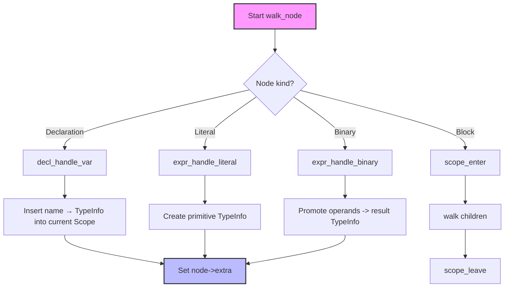

# Semantic Analysis Design (ZeroCC) – Full Detailed Plan

---

## 1. Objectives (recap)
- **AST walk** – compute a concrete C type for every expression/declaration.
- **C type system** – implement usual arithmetic conversions, pointer arithmetic, assignment compatibility, function‑call argument matching.
- **Identifier resolution** – TPHT‑backed symbol table with proper lexical scoping.
- **Diagnostics** – accurate line/column messages, continue‑on‑error to surface multiple issues.
- **Maintainability** – each source file < 900 LOC; logical separation; straightforward to extend.

---

## 2. Directory Layout (final)
```
src/zero_cc/
├─ semantic.h                # public API
├─ semantic.c                # façade (arena & diagnostics setup)
├─ semantic/                 # internal implementation
│   ├─ type.h                # TypeInfo definition & constructors
│   ├─ type.c                # allocation helpers, predicates
│   ├─ promote.h             # signatures for promotion utilities
│   ├─ promote.c             # arithmetic conversions, pointer rules
│   ├─ scope.h               # TPHT‑wrapped symbol table abstraction
│   ├─ scope.c               # push/pop scopes, insert/lookup
│   ├─ diagnostics.h         # DiagBuf API
│   ├─ diagnostics.c         # implementation of diagnostic buffer
│   ├─ visitor.h             # forward declarations for the recursive visitor
│   ├─ visitor.c             # dispatcher (walk_node) and generic helpers
│   ├─ expr_visitor.c        # expression handlers (literal, unary, binary, call, cast)
│   ├─ stmt_visitor.c        # statement handlers (if, while, for, switch, return, block)
│   ├─ decl_visitor.c        # declaration handlers (var, typedef, function prototype)
│   └─ utils.h               # tiny helpers (arena_index_to_ptr, etc.)
└─ …
```
Only **`semantic.h`** is exposed to the rest of the compiler.

---

## 3. Core Data Structures (expanded)
### 3.1 `TypeInfo`
```c
/* type.h */
#pragma once
#include "arena.h"

enum TypeKind {
    TYPE_VOID, TYPE_BOOL, TYPE_CHAR, TYPE_SHORT, TYPE_INT,
    TYPE_LONG, TYPE_FLOAT, TYPE_DOUBLE, TYPE_POINTER,
    TYPE_ARRAY, TYPE_FUNCTION, TYPE_STRUCT, TYPE_UNION, TYPE_ENUM
};

struct TypeInfo {
    enum TypeKind kind;
    union {
        struct { TypeInfo *base; size_t count; }   array;   // TYPE_ARRAY
        struct { TypeInfo *base; }                pointer; // TYPE_POINTER
        struct { TypeInfo **params; size_t param_cnt; TypeInfo *ret; } function; // TYPE_FUNCTION
        // Future extensions: struct/union fields, enum values, qualifiers
    } details;
};
```
All `TypeInfo` objects are allocated from the *permanent* arena via `type_new`.

### 3.2 `DiagBuf`
```c
/* diagnostics.h */
#pragma once
#include <stdarg.h>
#include "arena.h"

typedef struct {
    char   *msg;          // allocated in tmp arena
    uint32_t line, col;   // source location
} DiagEntry;

typedef struct {
    DiagEntry *entries;
    size_t     count, capacity;
    Arena     *tmp_arena;   // owns the message strings
} DiagBuf;

void diag_init(DiagBuf *buf, Arena *tmp);
void diag_report(DiagBuf *buf, uint32_t line, uint32_t col,
                 const char *fmt, ...);
bool diag_has_errors(const DiagBuf *buf);
void diag_print(const DiagBuf *buf);
```
`diag_report` formats using `vsnprintf` into a temporary‑arena buffer, guaranteeing no heap fragmentation.

### 3.3 `Scope`
```c
/* scope.h */
#pragma once
#include "zero_tpht.h"   // TPHT API (hash_table_tpht.c)
#include "type.h"

typedef struct Scope {
    ZeroFlattenTpht tpht;   // underlying TPHT instance
    struct Scope *parent;   // lexical nesting chain
} Scope;

Scope *scope_enter(Scope **cur, Arena *perm);
void   scope_leave(Scope **cur);
int    scope_put(Scope *s, const char *name, TypeInfo *type);
TypeInfo *scope_get(Scope *s, const char *name);
```
*Values stored in the TPHT* are **thin‑pointer indices** (`arena_index_of`) that map back to a `TypeInfo`.

---

## 4. Public API (`semantic.h`)
```c
#pragma once
#include "parser.h"
#include "arena.h"

typedef struct TypeInfo TypeInfo;   // opaque forward declaration

/**
 * Run the semantic analysis pass.
 * Returns 0 on success, non‑zero if any diagnostics were emitted.
 */
int semantic_analyze(ZeroCCASTNode *root,
                    Arena *perm_arena,
                    Arena *tmp_arena);

/* Inline helpers – real implementations live in type.c */
static inline TypeInfo *type_new(Arena *perm) {
    return (TypeInfo *)arena_alloc(perm, sizeof(TypeInfo));
}
```
All other helpers are hidden behind internal headers.

---

## 5. Implementation Roadmap (granular tasks)
### Milestone Breakdown
| Milestone | Files | Description | Owner | ETA |
|-----------|-------|-------------|-------|-----|
| **M1 – Diagnostics** | `diagnostics.h/c` | Implement `diag_init`, `diag_report`, `diag_print`. Simple unit test that captures a message. | – | 1 h |
| **M2 – Type System** | `type.h/c` | Constructors for primitive types, `type_is_*` predicates, `type_eq` (deep equality). | – | 1 h |
| **M3 – Scope Wrapper** | `scope.h/c` | Initialise TPHT (block count = 64), push/pop, thin‑pointer conversion helpers. | – | 1 h |
| **M4 – Promotion Utilities** | `promote.h/c` | Implement `promote_unary`, `promote_binary`, `type_common_real`, `type_compatible_assign`. Include exhaustive test matrix for all operator/op‑type combos. | – | 3 h |
| **M5 – Visitor Dispatcher** | `visitor.h/c` | Recursive `walk_node`, generic error helper `node_error`. Handles scope entry/exit for blocks. | – | 2 h |
| **M6 – Expression Handlers** | `expr_visitor.c` | Functions: `expr_handle_literal`, `expr_handle_unary`, `expr_handle_binary`, `expr_handle_call`, `expr_handle_cast`. Each returns the computed `TypeInfo*` and sets `node->extra`. | – | 2 h |
| **M7 – Statement Handlers** | `stmt_visitor.c` | Functions: `stmt_handle_if`, `stmt_handle_while`, `stmt_handle_for`, `stmt_handle_switch`, `stmt_handle_return`, `stmt_handle_block`. Verify control‑flow constraints (e.g., cannot `break` outside a loop). | – | 2 h |
| **M8 – Declaration Handlers** | `decl_visitor.c` | Functions: `decl_handle_var`, `decl_handle_typedef`, `decl_handle_function_proto`. Insert symbols into current `Scope`. | – | 2 h |
| **M9 – Facade (`semantic.c`)** | `semantic.c` | Initialise `DiagBuf`, create the global `Scope`, invoke `walk_node`, print diagnostics, clean up. | – | 1 h |
| **M10 – Build System** | `Makefile` / `CMakeLists.txt` | Add all new source files to the compiler target, ensure `semantic.h` is exported. | – | 0.5 h |
| **M11 – Tests & Documentation** | `test/semantic_error.c`, README update | Add a golden test that fails (`int *p = 1;`). Extend README with a *Semantic analysis* section and a mermaid dependency diagram. | – | 1 h |

**Total Estimated Effort:** ~15 hours.

---

## 6. Detailed Function Sketches
### 6.1 `semantic_analyze` (semantic.c)
```c
int semantic_analyze(ZeroCCASTNode *root, Arena *perm, Arena *tmp) {
    DiagBuf diag; diag_init(&diag, tmp);
    Scope *global = NULL; scope_enter(&global, perm);   // global scope
    int rc = walk_node(root, perm, tmp, &diag, global);
    if (diag_has_errors(&diag)) {
        diag_print(&diag);
        rc = 1; // signal failure
    }
    scope_leave(&global);
    return rc;
}
```
`walk_node` receives the current `Scope` pointer and propagates it to children.

### 6.2 Dispatcher (`visitor.c`)
```c
static int walk_node(ZeroCCASTNode *n, Arena *perm, Arena *tmp,
                     DiagBuf *diag, Scope *scope) {
    if (!n) return 0;
    switch (n->tag) {
        /* literals */
        case NODE_INT_LITERAL:   return expr_handle_literal(n, perm, diag);
        case NODE_FLOAT_LITERAL: return expr_handle_literal(n, perm, diag);
        case NODE_STRING_LITERAL:return expr_handle_literal(n, perm, diag);
        
        /* expressions */
        case NODE_UNARY:         return expr_handle_unary(n, perm, tmp, diag, scope);
        case NODE_BINOP:         return expr_handle_binary(n, perm, tmp, diag, scope);
        case NODE_CALL:          return expr_handle_call(n, perm, tmp, diag, scope);
        case NODE_CAST:          return expr_handle_cast(n, perm, tmp, diag, scope);
        
        /* declarations */
        case NODE_DECL:          return decl_handle_var(n, perm, tmp, diag, scope);
        case NODE_TYPEDEF_DECL:  return decl_handle_typedef(n, perm, tmp, diag, scope);
        case NODE_FUNCTION_DECL: return decl_handle_function_proto(n, perm, tmp, diag, scope);
        
        /* statements */
        case NODE_IF:            return stmt_handle_if(n, perm, tmp, diag, scope);
        case NODE_WHILE:         return stmt_handle_while(n, perm, tmp, diag, scope);
        case NODE_FOR:           return stmt_handle_for(n, perm, tmp, diag, scope);
        case NODE_BLOCK: {
            Scope *inner = NULL; scope_enter(&inner, perm);
            int r = stmt_handle_block(n, perm, tmp, diag, inner);
            scope_leave(&inner);
            return r;
        }
        case NODE_RETURN:        return stmt_handle_return(n, perm, tmp, diag, scope);
        case NODE_BREAK:         return stmt_handle_break(n, perm, tmp, diag, scope);
        case NODE_CONTINUE:      return stmt_handle_continue(n, perm, tmp, diag, scope);
        
        default:
            // Unknown or not yet handled – silently ignore for now
            return 0;
    }
}
```
Each handler returns **0 on success**, otherwise non‑zero; most errors are emitted via `diag_report`.

### 6.3 Example: Binary‑operator handler (`expr_visitor.c`)
```c
int expr_handle_binary(ZeroCCASTNode *n, Arena *perm, Arena *tmp,
                       DiagBuf *diag, Scope *scope) {
    // recursively type sub‑expressions
    walk_node(n->left,  perm, tmp, diag, scope);
    walk_node(n->right, perm, tmp, diag, scope);
    TypeInfo *lt = node_type(n->left);
    TypeInfo *rt = node_type(n->right);
    TypeInfo *res = promote_binary(n->aux.op, lt, rt, perm, diag);
    if (!res) {
        diag_report(diag, n->line, n->col,
                    "invalid operands to binary operator %u", n->aux.op);
        return 1;
    }
    node_set_type(n, res, perm);
    return 0;
}
```
`promote_binary` lives in `promote.c` and implements the *usual arithmetic conversions* plus the special pointer‑addition/subtraction cases.

### 6.4 Promotion utilities (`promote.c` – outline)
```c
/* Helper predicates */
static bool type_is_integer(const TypeInfo *t) { return t->kind == TYPE_CHAR || t->kind == TYPE_SHORT || t->kind == TYPE_INT || t->kind == TYPE_LONG; }
static bool type_is_floating(const TypeInfo *t) { return t->kind == TYPE_FLOAT || t->kind == TYPE_DOUBLE; }
static bool type_is_pointer(const TypeInfo *t) { return t->kind == TYPE_POINTER; }

/* Integer promotion */
static TypeInfo *integer_promote(const TypeInfo *t, Arena *perm) {
    if (t->kind == TYPE_CHAR || t->kind == TYPE_SHORT) {
        return type_int(perm); // promote to int (unsigned handling omitted for brevity)
    }
    return (TypeInfo *)t; // already int/long
}

/* Usual arithmetic conversion */
TypeInfo *promote_binary(uint32_t op, const TypeInfo *l, const TypeInfo *r,
                         Arena *perm, DiagBuf *diag) {
    // 1. Integer promotion
    const TypeInfo *lp = type_is_integer(l) ? integer_promote(l, perm) : l;
    const TypeInfo *rp = type_is_integer(r) ? integer_promote(r, perm) : r;

    // 2. Floating‑point handling
    if (type_is_floating(lp) || type_is_floating(rp)) {
        // If either operand is double -> double, else float
        return type_is_floating(lp) && lp->kind == TYPE_DOUBLE ||
               type_is_floating(rp) && rp->kind == TYPE_DOUBLE ? type_double(perm) : type_float(perm);
    }

    // 3. Pointer arithmetic (only for + and -)
    if (type_is_pointer(lp) && type_is_integer(rp) && (op == '+' || op == '-')) {
        return (TypeInfo *)lp; // result same pointer type
    }
    if (type_is_pointer(rp) && type_is_integer(lp) && op == '+') {
        return (TypeInfo *)rp;
    }
    if (type_is_pointer(lp) && type_is_pointer(rp) && op == '-') {
        return type_long(perm); // ptrdiff_t – treat as signed long for now
    }

    // 4. Remaining integer case – simplified rank rules
    if (lp->kind == TYPE_LONG || rp->kind == TYPE_LONG) return type_long(perm);
    return type_int(perm);
}
```
The real implementation will also handle unsigned variants, rank ordering, and warnings for lossy conversions.

---

## 7. Symbol Table Interaction Flow (Mermaid diagram)

The diagram visualises how each node type routes to a handler, which may interact with the TPHT‑based `Scope`.

---

## 8. Testing Plan (expanded)
| Test | Description | Expected outcome |
|------|-------------|------------------|
| `type_test.c` | Verify constructors (`type_int`, `type_ptr`, etc.) and `type_is_*` predicates. | Assertions succeed.
| `promote_test.c` | Matrix of operand type pairs for each binary operator (`+ - * / & | ^`). | `promote_binary` returns the correct `TypeInfo` kind.
| `scope_test.c` | Insert symbols, nest scopes, shadowing, lookup failures. | Correct type retrieved, shadowing works, unknown name returns NULL.
| `semantic_error.c` (golden) | Source file with intentional type errors (e.g., `int *p = 1;`, `p + q` where both are pointers). | Compiler exits non‑zero, diagnostic contains the specific message.
| Regression suite (`make test`) | Run the existing JIT tests after semantic pass is enabled. | All original tests still pass (no new errors).

Each test will be compiled with the existing `test/` harness using a new `make test-semantic` target that builds the compiler with the semantic pass.

---

## 9. Integration Steps (precise)
1. **Create `src/zero_cc/semantic/` directory.**
2. **Add stub headers** with function prototypes and brief comments.
3. **Implement M1–M4** – they have no dependencies on the visitor.
4. **Implement M5 (visitor)** – depends on `type`, `promote`, `scope`, `diagnostics`.
5. **Add `semantic.c`** that calls the visitor.
6. **Modify the build system**:
   ```make
   # In the compiler target
   SRCS += src/zero_cc/semantic.c \
           src/zero_cc/semantic/type.c \
           src/zero_cc/semantic/promote.c \
           src/zero_cc/semantic/scope.c \
           src/zero_cc/semantic/diagnostics.c \
           src/zero_cc/semantic/visitor.c \
           src/zero_cc/semantic/expr_visitor.c \
           src/zero_cc/semantic/stmt_visitor.c \
           src/zero_cc/semantic/decl_visitor.c
   ```
7. **Update driver** (`zero_cc.c` or equivalent) to invoke `semantic_analyze` after parsing.
8. **Run full test suite** – fix any compile‑time errors, then add new semantic tests.
9. **Documentation** – Add a *Semantic analysis* section to `README.md` with a brief overview and a link to this `SEMANTIC.md`.

---

## 10. Timeline (working days)
| Day | Tasks |
|-----|-------|
| **Day 1** | Create directory, stub headers. Implement M1–M3. Write unit tests for diagnostics, type constructors, and scope basics. |
| **Day 2** | Implement promotion utilities (M4) and exhaustive test matrix. |
| **Day 3** | Implement visitor dispatcher (M5) and expression handlers (M6). Verify with simple expressions. |
| **Day 4** | Implement statement handlers (M7) and declaration handlers (M8). Add symbol‑resolution tests. |
| **Day 5** | Finish façade (`semantic.c`), integrate into build system, update driver, run full regression suite. |
| **Day 6** | Add golden error test, update README, final polish, code review. |

---

## 11. Risk Mitigation & Extensibility
* **Risk:** Promotion matrix becomes large and error‑prone.
  *Mitigation:* Centralise all rank/unsigned logic in `type.c` helpers; unit‑test every branch.
* **Risk:** TPHT lookup performance regressions.
  *Mitigation:* Scope wrapper keeps a shallow pointer to the underlying TPHT; benchmarks can be added later.
* **Extensibility:** Adding struct/union fields only requires extending `TypeInfo` and implementing a new visitor routine (`decl_handle_struct`). The rest of the pipeline (promotion, diagnostics) remains unchanged.

---

## 12. Next Immediate Action
Create the `src/zero_cc/semantic/` directory and add **stub files** (`type.h`, `type.c`, `diagnostics.h`, `diagnostics.c`). Implement **M1 – Diagnostics** (basic `diag_init`, `diag_report`, `diag_print`) and run a tiny test to confirm the buffer works. Once that is stable, proceed to **M2 – Type System**.

---

*Prepared for the repository at `/home/ubuntu/dev/qnz_c_compiler`.*
