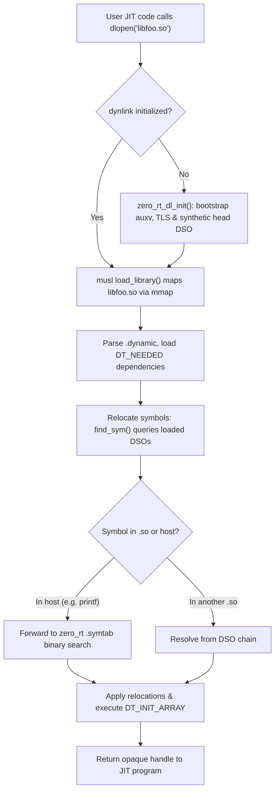

# Host Runtime, In-Process Dynamic Loading & Portability Architecture

This concept document defines the architectural strategy for ZeroCC's host runtime, self-contained static execution, JIT symbol resolution, freestanding/baremetal deployment, and portability across non-Linux operating systems.

- **Root Navigator**: [index.md](./index.md)
- **Freestanding Runtime Target**: [zero-rt.md](./zero-rt.md)
- **Internal Linker**: [own-linker.md](./own-linker.md)
- **ISA Backends**: [isa-backends.md](./isa-backends.md)

---

## 1. Static-Musl Host Toolchain & Current JIT Architecture

Starting in Sprint 143, `build/bin/zerocc` and test executables linking the compiler are fully statically linked against in-tree vendored musl (`third_party/vendor/musl/musl-1.2.6`), removing all runtime dependencies on host glibc (`ldd: "not a dynamic executable"`).

### Core Mechanics
1. **`--whole-archive $(MUSL_LIBC)`**:
   Static linkers only pull objects from an archive if referenced by the compiler binary. Because the compiler itself never calls user math routines (`sin`, `cos`, `pow`), formatting utilities, or POSIX sockets, `--whole-archive` bakes the entire musl C library into the executable's `.symtab`.
2. **Self-Hosting `dlfcn` (`zero_rt/dlfcn/dlfcn.c`)**:
   Static musl ships dummy stubs for `dlopen`/`dlsym`/`dlclose`/`dlerror` that always fail (`"Dynamic loading not supported"`). The build strips these stubs from `libc.a`. ZeroCC provides a self-hosting `dlfcn` linked ahead of musl:
   - **Primary source (Sprint 153)**: a pre-baked `.rodata` symbol table generated at build time (`tools/embed_symtab.py`, see below) — `dlsym` is an in-memory $O(\log N)$ binary search with **zero filesystem access**.
   - **Fallback**: when the embedded table is empty (bootstrap build) or `ZERO_RT_DL=proc` forces it, the original path inspects its own ELF `.symtab` via `/proc/self/exe`: parse section headers (`SHT_SYMTAB`), build a name-sorted in-memory index, binary-search.
3. **`-no-pie` (Static `ET_EXEC`)**:
   Keeps `.symtab` `st_value` addresses absolute, avoiding the need to compute runtime ASLR load base offsets (though `ET_DYN` fallback is supported via `/proc/self/maps`).
4. **Far-Call Trampoline Pool (`src/zero_cc/jit/execution.h`)**:
   The static executable image is mapped at low addresses (~`0x400000`), whereas anonymous `mmap` pages for JIT execution reside at high virtual addresses (~128 GB away). Because x86-64 `call rel32` only reaches $\pm 2\text{ GB}$, the JIT reserves a 14-byte detour trampoline pool (`ff 25 00 00 00 00` + 8-byte absolute address) in the executable JIT region so standard calls can reach libc.

---

## 2. In-Process Dynamic Linker Adaptation (`musl ldso/dynlink.c`)

### The Limitations of the Current Approach
1. **No Third-Party `.so` Loading**: JITed user programs cannot dynamically load external shared libraries via `dlopen("libfoo.so")`.
2. **`/proc` Dependency** *(eliminated in Sprint 153 for the driver; the `/proc/self/exe` walk remains only as a fallback for bootstrap/`ZERO_RT_DL=proc`)*: restricted environments (chroots, secure containers without procfs, baremetal) previously broke JIT symbol resolution; the embedded table (Phase 1) removes the dependency.

### The Static `dlopen` Adaptation
To resolve these limitations without sacrificing static hermeticity, ZeroCC adapts musl's own dynamic loader (`third_party/vendor/musl/musl-1.2.6/ldso/dynlink.c`) into `zero_rt/dlfcn/`:

1. **Synthetic `head` DSO**: A bootstrap routine (`zero_rt_dl_init`) initialises musl's internal dynamic linker state, creating a synthetic root DSO representing the static executable.
2. **Symbol Bridging**: In `dynlink.c`, symbol searches on `head` forward to ZeroCC's existing `.symtab` lookup, making all whole-archived musl symbols available to loaded `.so` files.
3. **Embedded Symbol Table (`.rodata`) — SHIPPED (Sprint 153)**: `tools/embed_symtab.py` pre-bakes the executable's defined global symbols into a `.rodata` array `g_zero_rt_embedded_syms[]` (+ `g_zero_rt_embedded_sym_count`) in a generated `build/gen/embedded_syms.c`, **without absolute addresses**: each entry takes the symbol's address by reference (`extern void name(void);` / `extern char name[];` + `&name`), i.e. a link-time relocation. The table is therefore correct after *any* relink — no two-pass fixpoint, no fixed-size reservation, no staleness (an absolute-constant bake would shift `.rodata`-downstream symbols and corrupt itself). The `build/bin/zerocc` Makefile rule links once, regenerates the table from the fresh binary (`nm --defined-only`), and relinks once if it changed (the generator rewrites only on content change and exits 3, so an up-to-date build is a no-op; a fresh build bootstraps via a sentinel-only table). Selection mirrors real-`dlsym` semantics: defined globals only (uppercase nm types `T D B R` strong, `W V` weak; locals unreachable by name), valid-C-identifier names, strong beats weak on duplicates, bytewise name sort. `dlfcn.c` carries **weak sentinel-only defaults** for the two table symbols, so test binaries that link `dlfcn.o` without the generated file stay self-contained (count 0 keeps the `/proc` fallback live; the strong generated definitions win in the driver). `ZERO_RT_DL=embedded`/`proc` force one path (the embedded probe is the hardened-container test). Verification: `test/unit/dlfcn_embedded_test.c` (embedded vs `/proc` discrimination: `malloc` must NOT resolve in embedded mode against a 3-entry fake table) + `test/driver/dlopen_embedded.c` via `tools/driver_tests.py` in all three modes (every JIT far call — `dlopen`/`dlsym`/`printf`/`malloc`/`zc_alloc_temp` — resolves through the driver's embedded table; `zc_alloc_temp` proves the table is the driver's own). **Sprint 155 — hidden visibility (dynamic/ASan safety):** the four public `dlopen`/`dlsym`/`dlclose`/`dlerror` are compiled with `visibility("hidden")` so they stay resolvable *in-process* (the JIT self-hosting path and the dlfcn tests still bind to the local definitions) but are **not exported to `.dynsym`**. In a dynamic build (e.g. the `make asan` sanitizer tree) an exported `dlsym` would shadow the host libc's and intercept the ASan runtime's own startup `dlsym(RTLD, "_thread_db_sizeof_pthread")` probe (`AsanInitInternal`→`InitTlsSize`); routed here, that probe hits the `malloc` + `/proc/self/exe` walk in `zero_rt_sym_build`, which is unsafe mid-sanitizer-init (silent SIGSEGV before any user code). Hiding removes the `.dynsym` export so the ASan runtime (a `.so`) resolves `dlsym` to libc's instead. A fully static build has no `.dynsym` and is unaffected.
4. **In-Process Dynamic Loader (`zero_rt/dlfcn/dynlink.c` + `dynlink.h`) — Phase 2 & 3 SHIPPED**:
   - **Phase 2 (MVP ELF64 Loader)**: Loads real ELF64 `.so` shared objects into the static-musl host process (`dlopen("/path/to/lib.so", ...)`). Maps all `PT_LOAD` segments from their exact file offsets (`p_offset` → `base + (p_vaddr - map_start)`) with trailing `p_memsz - p_filesz` zero-fill, parses `PT_DYNAMIC` (`DT_STRTAB`, `DT_SYMTAB`, `DT_GNU_HASH`, `DT_HASH`, `DT_RELA`/`DT_RELASZ`, `DT_JMPREL`/`DT_PLTRELSZ`, `DT_INIT`, `DT_INIT_ARRAY`/`DT_INIT_ARRAYSZ`), applies x86-64 RELA relocations (`R_X86_64_RELATIVE`, `R_X86_64_64`, `R_X86_64_GLOB_DAT`, `R_X86_64_JUMP_SLOT`, resolving host symbols via `zero_rt_host_sym_lookup` and weak undefined symbols to `0`), runs constructors, and supports `dlsym(handle, ...)` / `dlsym(RTLD_DEFAULT, ...)` and `dlclose(handle)`.
   - **Phase 3 (Search Paths, Dependencies & Versioning)**:
     - *Search Paths*: Resolves bare library names (e.g. `dlopen("libfoo.so")`) across caller DSO `DT_RPATH` / `DT_RUNPATH` (with `$ORIGIN` / `${ORIGIN}` expansion to caller directory), `LD_LIBRARY_PATH` (colon-delimited), and standard system directories (`/lib/x86_64-linux-gnu`, `/usr/lib/x86_64-linux-gnu`, `/lib64`, `/usr/lib64`, `/lib`, `/usr/lib`, `/usr/local/lib`).
     - *Recursive DT_NEEDED Dependencies*: Automatically loads dependencies declared in `DT_NEEDED`. Cycle-safe insertion into `g_zc_list` breaks cyclic dependencies; dependency constructors run strictly before dependent constructors; breadth-first transitive search in `zc_scope_lookup` resolves symbols through the dependency hierarchy; folded host libraries (`libc`, `libm`, etc.) fold into `g_zc_head`.
     - *GNU Symbol Versioning*: Parses `DT_VERSYM` (`.gnu.version`), `DT_VERDEF` (`.gnu.version_d`), and `DT_VERNEED` (`.gnu.version_r`). Default `dlsym` filters out hidden versions (`versym[i] & 0x8000`); `dlvsym(handle, name, version)` resolves exact versions matching `verdef`/`verneed` records.
   - Verified by `test/unit/dlfcn_dynlink.c` in both host binary (`musl-gcc`) and JIT (`./build/bin/zerocc --run`) modes.
5. **Why `--whole-archive` Remains Mandatory**: User JIT code does not explicitly `dlopen("libc.so")` to call `printf` or `sin`. The entire C runtime must remain present in the host binary image.

---

## 3. Freestanding & Baremetal Execution Architecture

In a freestanding environment (embedded microcontrollers, kernels, bootloaders, or IoT devices without an OS), dynamic loading and POSIX syscalls do not exist.

### AOT Mode (`--zerocc-link`)
ZeroCC compiles directly for freestanding targets using [`zero_rt.a`](./zero-rt.md):
- **Zero Host libc / Musl**: Programs link against `zero_rt.a` (written in clean C, compiled by ZeroCC itself).
- **Hardware BSP Boundary**: The OS syscall boundary (`zero_rt/linux/os.c`) is replaced by a Board Support Package (BSP):
  - `write()` routes to a hardware UART MMIO FIFO.
  - `brk()` / `sbrk()` bumps a pointer from the linker script's `_end` symbol in RAM.
  - `exit()` halts the CPU via `hlt` or `wfi`.

### Baremetal JIT & Dynamic Code Execution
When dynamic code execution is required on baremetal (e.g. in-kernel JIT, eBPF, firmware plugins):
1. **Flash Symbol Registry**: Symbol lookup queries a `const BaremetalSym g_firmware_symbols[]` table stored in ROM/Flash.
2. **Static RAM Allocation**: JIT code is written to a pre-allocated static RAM pool (`uint8_t g_jit_pool[]`).
3. **Instruction Cache Maintenance**: The JIT flushes data caches and invalidates instruction caches:
   - **RISC-V**: `fence.i`
   - **AArch64 / ARM**: `dsb ish; ic iallu; isb`
4. **Relocatable ELF Modules (`.o`)**: Instead of complex `.so` dynamic libraries, baremetal systems load static relocatable `.o` objects and resolve relocations in-place in RAM.

---

## 4. Non-Linux Host Portability Architecture

Because musl is Linux-specific (issuing Linux `syscall` instructions directly), non-Linux host platforms require native runtime adaptations:

| Operating System | Executable Format | Host C Runtime | Executable Path Discovery | JIT Memory Allocation | Dynamic Symbol Resolution |
| :--- | :--- | :--- | :--- | :--- | :--- |
| **Linux (Default)** | ELF (static `ET_EXEC`) | Vendored musl (`libc.a`) | Pre-baked `.rodata` symtab (Sprint 153); `/proc/self/exe` fallback | `mmap` + detour trampolines | `zero_rt/dlfcn/dlfcn.c` (embedded table, else .symtab search) |
| **macOS (Darwin)** | Mach-O | `libSystem.B.dylib` (dynamic only) | `_NSGetExecutablePath()` | `mmap` + `pthread_jit_write_protect_np()` | Native `dlsym(RTLD_DEFAULT)` |
| **Windows** | PE/COFF | Static UCRT (`/MT`) or Mingw | `GetModuleFileNameA()` | `VirtualAlloc()` + `FlushInstructionCache()` | `GetProcAddress(GetModuleHandle(NULL))` |
| **BSDs (FreeBSD/OpenBSD)** | ELF | Native BSD libc | `sysctl(KERN_PROC_PATHNAME)` | `mmap` (OpenBSD requires `wxneeded`) | Native BSD `dlsym` |

### Key Platform-Specific Invariants
- **macOS W^X Security**: Darwin strictly forbids pages that are simultaneously W and X. On Apple Silicon, code emission must be wrapped in `pthread_jit_write_protect_np(0)` (write mode) and `pthread_jit_write_protect_np(1)` (execute mode) with the `allow-jit` entitlement.
- **Windows Memory**: Replaces POSIX `mmap` with `VirtualAlloc(PAGE_EXECUTE_READWRITE)` and explicitly calls `FlushInstructionCache()`.
- **OpenBSD Security**: Requires linking with `-Wl,-z,wxneeded` and executing `pledge("prot_exec", ...)` to permit JIT execution.
