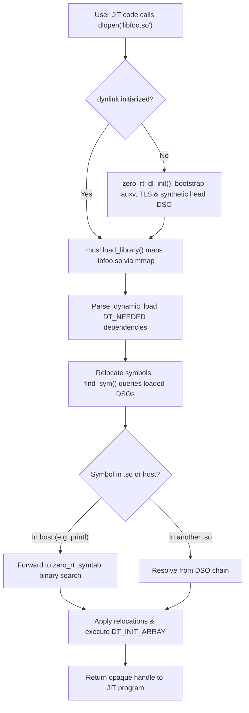
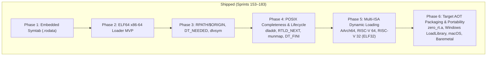

# Host Runtime, In-Process Dynamic Loading & Portability Architecture

This concept document defines the architectural strategy for ZeroCC's host runtime, self-contained static execution, JIT symbol resolution, freestanding/baremetal deployment, and portability across non-Linux operating systems.

- **Root Navigator**: [index.md](./index.md)
- **Freestanding Runtime Target**: [zero-rt.md](./zero-rt.md)
- **Internal Linker**: [own-linker.md](./own-linker.md)
- **ISA Backends**: [isa-backends.md](./isa-backends.md)

---

## 1. Static-Musl Host Toolchain & Current JIT Architecture

Starting in Sprint 143, `build/bin/zerocc` and test executables linking the compiler are fully statically linked against in-tree vendored musl (`third_party/vendor/musl/musl-1.2.6`), removing all runtime dependencies on host glibc (`ldd: "not a dynamic executable"`).

### Core Mechanics
1. **`--whole-archive $(MUSL_LIBC)`**:
   Static linkers only pull objects from an archive if referenced by the compiler binary. Because the compiler itself never calls user math routines (`sin`, `cos`, `pow`), formatting utilities, or POSIX sockets, `--whole-archive` bakes the entire musl C library into the executable's `.symtab`.
2. **Self-Hosting `dlfcn` (`zero_rt/dlfcn/dlfcn.c`)**:
   Static musl ships dummy stubs for `dlopen`/`dlsym`/`dlclose`/`dlerror` that always fail (`"Dynamic loading not supported"`). The build strips these stubs from `libc.a`. ZeroCC provides a self-hosting `dlfcn` linked ahead of musl:
   - **Primary source (Sprint 153)**: a pre-baked `.rodata` symbol table generated at build time (`tools/embed_symtab.py`, see below) — `dlsym` is an in-memory $O(\log N)$ binary search with **zero filesystem access**.
   - **Fallback**: when the embedded table is empty (bootstrap build) or `ZERO_RT_DL=proc` forces it, the original path inspects its own ELF `.symtab` via `/proc/self/exe`: parse section headers (`SHT_SYMTAB`), build a name-sorted in-memory index, binary-search.
3. **`-no-pie` (Static `ET_EXEC`)**:
   Keeps `.symtab` `st_value` addresses absolute, avoiding the need to compute runtime ASLR load base offsets (though `ET_DYN` fallback is supported via `/proc/self/maps`).
4. **Far-Call Trampoline Pool (`src/zero_cc/jit/execution.h`)**:
   The static executable image is mapped at low addresses (~`0x400000`), whereas anonymous `mmap` pages for JIT execution reside at high virtual addresses (~128 GB away). Because x86-64 `call rel32` only reaches $\pm 2\text{ GB}$, the JIT reserves a 14-byte detour trampoline pool (`ff 25 00 00 00 00` + 8-byte absolute address) in the executable JIT region so standard calls can reach libc.

---

## 2. In-Process Dynamic Linker Adaptation (`musl ldso/dynlink.c`)

### The Limitations of the Current Approach
1. **No Third-Party `.so` Loading**: JITed user programs cannot dynamically load external shared libraries via `dlopen("libfoo.so")`.
2. **`/proc` Dependency** *(eliminated in Sprint 153 for the driver; the `/proc/self/exe` walk remains only as a fallback for bootstrap/`ZERO_RT_DL=proc`)*: restricted environments (chroots, secure containers without procfs, baremetal) previously broke JIT symbol resolution; the embedded table (Phase 1) removes the dependency.

### The Static `dlopen` Adaptation
To resolve these limitations without sacrificing static hermeticity, ZeroCC adapts musl's own dynamic loader (`third_party/vendor/musl/musl-1.2.6/ldso/dynlink.c`) into `zero_rt/dlfcn/`:



1. **Synthetic `head` DSO**: A bootstrap routine (`zero_rt_dl_init`) initialises musl's internal dynamic linker state, creating a synthetic root DSO representing the static executable.
2. **Symbol Bridging**: In `dynlink.c`, symbol searches on `head` forward to ZeroCC's existing `.symtab` lookup, making all whole-archived musl symbols available to loaded `.so` files.
3. **Embedded Symbol Table (`.rodata`) — SHIPPED (Sprint 153)**: `tools/embed_symtab.py` pre-bakes the executable's defined global symbols into a `.rodata` array `g_zero_rt_embedded_syms[]` (+ `g_zero_rt_embedded_sym_count`) in a generated `build/gen/embedded_syms.c`, **without absolute addresses**: each entry takes the symbol's address by reference (`extern void name(void);` / `extern char name[];` + `&name`), i.e. a link-time relocation. The table is therefore correct after *any* relink — no two-pass fixpoint, no fixed-size reservation, no staleness (an absolute-constant bake would shift `.rodata`-downstream symbols and corrupt itself). The `build/bin/zerocc` Makefile rule links once, regenerates the table from the fresh binary (`nm --defined-only`), and relinks once if it changed (the generator rewrites only on content change and exits 3, so an up-to-date build is a no-op; a fresh build bootstraps via a sentinel-only table). Selection mirrors real-`dlsym` semantics: defined globals only (uppercase nm types `T D B R` strong, `W V` weak; locals unreachable by name), valid-C-identifier names, strong beats weak on duplicates, bytewise name sort. `dlfcn.c` carries **weak sentinel-only defaults** for the two table symbols, so test binaries that link `dlfcn.o` without the generated file stay self-contained (count 0 keeps the `/proc` fallback live; the strong generated definitions win in the driver). `ZERO_RT_DL=embedded`/`proc` force one path (the embedded probe is the hardened-container test). Verification: `test/unit/dlfcn_embedded_test.c` (embedded vs `/proc` discrimination: `malloc` must NOT resolve in embedded mode against a 3-entry fake table) + `test/driver/dlopen_embedded.c` via `tools/driver_tests.py` in all three modes (every JIT far call — `dlopen`/`dlsym`/`printf`/`malloc`/`zc_alloc_temp` — resolves through the driver's embedded table; `zc_alloc_temp` proves the table is the driver's own). **Sprint 155 — hidden visibility (dynamic/ASan safety):** the four public `dlopen`/`dlsym`/`dlclose`/`dlerror` are compiled with `visibility("hidden")` so they stay resolvable *in-process* (the JIT self-hosting path and the dlfcn tests still bind to the local definitions) but are **not exported to `.dynsym`**. In a dynamic build (e.g. the `make asan` sanitizer tree) an exported `dlsym` would shadow the host libc's and intercept the ASan runtime's own startup `dlsym(RTLD, "_thread_db_sizeof_pthread")` probe (`AsanInitInternal`→`InitTlsSize`); routed here, that probe hits the `malloc` + `/proc/self/exe` walk in `zero_rt_sym_build`, which is unsafe mid-sanitizer-init (silent SIGSEGV before any user code). Hiding removes the `.dynsym` export so the ASan runtime (a `.so`) resolves `dlsym` to libc's instead. A fully static build has no `.dynsym` and is unaffected.
4. **In-Process Dynamic Loader (`zero_rt/dlfcn/dynlink.c` + `dynlink.h`) — Phase 2 & 3 SHIPPED**:
   - **Phase 2 (MVP ELF64 Loader)**: Loads real ELF64 `.so` shared objects into the static-musl host process (`dlopen("/path/to/lib.so", ...)`). Maps all `PT_LOAD` segments from their exact file offsets (`p_offset` → `base + (p_vaddr - map_start)`) with trailing `p_memsz - p_filesz` zero-fill, parses `PT_DYNAMIC` (`DT_STRTAB`, `DT_SYMTAB`, `DT_GNU_HASH`, `DT_HASH`, `DT_RELA`/`DT_RELASZ`, `DT_JMPREL`/`DT_PLTRELSZ`, `DT_INIT`, `DT_INIT_ARRAY`/`DT_INIT_ARRAYSZ`), applies x86-64 RELA relocations (`R_X86_64_RELATIVE`, `R_X86_64_64`, `R_X86_64_GLOB_DAT`, `R_X86_64_JUMP_SLOT`, resolving host symbols via `zero_rt_host_sym_lookup` and weak undefined symbols to `0`), runs constructors, and supports `dlsym(handle, ...)` / `dlsym(RTLD_DEFAULT, ...)` and `dlclose(handle)`.
   - **Phase 3 (Search Paths, Dependencies & Versioning)**:
     - *Search Paths*: Resolves bare library names (e.g. `dlopen("libfoo.so")`) across caller DSO `DT_RPATH` / `DT_RUNPATH` (with `$ORIGIN` / `${ORIGIN}` expansion to caller directory), `LD_LIBRARY_PATH` (colon-delimited), and standard system directories (`/lib/x86_64-linux-gnu`, `/usr/lib/x86_64-linux-gnu`, `/lib64`, `/usr/lib64`, `/lib`, `/usr/lib`, `/usr/local/lib`).
     - *Recursive DT_NEEDED Dependencies*: Automatically loads dependencies declared in `DT_NEEDED`. Cycle-safe insertion into `g_zc_list` breaks cyclic dependencies; dependency constructors run strictly before dependent constructors; breadth-first transitive search in `zc_scope_lookup` resolves symbols through the dependency hierarchy; folded host libraries (`libc`, `libm`, etc.) fold into `g_zc_head`.
     - *GNU Symbol Versioning*: Parses `DT_VERSYM` (`.gnu.version`), `DT_VERDEF` (`.gnu.version_d`), and `DT_VERNEED` (`.gnu.version_r`). Default `dlsym` filters out hidden versions (`versym[i] & 0x8000`); `dlvsym(handle, name, version)` resolves exact versions matching `verdef`/`verneed` records.
   - Verified by `test/unit/dlfcn_dynlink.c` in both host binary (`musl-gcc`) and JIT (`./build/bin/zerocc --run`) modes.
5. **Why `--whole-archive` Remains Mandatory**: User JIT code does not explicitly `dlopen("libc.so")` to call `printf` or `sin`. The entire C runtime must remain present in the host binary image.

### 2.1. ZeroCC Architectural Differentiator: In-Process Dynamic Loading in a Static Host

Standard C toolchains face an inherent trade-off between **static hermeticity** and **dynamic extensibility**:
- **glibc**’s dynamic loader (`ld-linux.so`) requires an installed glibc host environment. In a static glibc executable (`gcc -static`), calling `dlopen()` issues link warnings and frequently crashes on host version skew (NSS, pthreads).
- **musl** provides a clean static archive (`libc.a`), but upstream musl disables dynamic loading entirely in static binaries (`dlopen()` returns `ENOSYS`: *"Dynamic loading not supported"*). Furthermore, musl intentionally lacks `dlvsym()`.
- **Clang / LLVM JIT** delegates external `.so` resolution directly to the host OS `dlopen()`. In a static musl binary, Clang's JIT loses the ability to load external shared objects.

**ZeroCC eliminates this trade-off**:
The compiler binary (`build/bin/zerocc`) is a 100% static musl executable (`ldd`: `"not a dynamic executable"`), yet it embeds a complete in-process ELF64 dynamic linker (`zero_rt/dlfcn/dynlink.c`):
1. **Zero Host glibc Dependency**: ZeroCC runs in minimal `scratch`, distroless, or Alpine environments without glibc or system `ld.so`, yet JIT code can dynamically load real `.so` shared objects (vendor hardware drivers, proprietary SDKs, graphics/audio plugins).
2. **Full GNU Symbol Versioning**: Unlike musl, ZeroCC parses `.gnu.version` tables, filters hidden versions for standard `dlsym()`, and implements `dlvsym(handle, name, version)`.
3. **Host Symbol Bridging**: Loaded `.so` libraries call back into static musl symbols in the host binary (e.g., `malloc`, `printf`, `sin`) via the pre-baked `.rodata` embedded symbol table (`tools/embed_symtab.py`).
4. **Self-Contained Relocatable Layouts**: Native support for `$ORIGIN` / `${ORIGIN}` expansion in `DT_RPATH` / `DT_RUNPATH` and recursive `DT_NEEDED` allows vendor libraries to ship in self-contained folders without root installation.
5. **Direct Filesystem Resolution (Host Cache Independence)**:
   - ZeroCC does **not** depend on host configuration files or cache files like `/etc/ld.so.cache` (glibc) or `/etc/ld-musl-*.path` (musl).
   - Instead, ZeroCC checks the standard directories directly using `access(candidate, R_OK)`:
     1. Caller DSO's `DT_RPATH` / `DT_RUNPATH` (with `$ORIGIN` expansion)
     2. `LD_LIBRARY_PATH` directories (colon-separated)
     3. Standard system multiarch and fallback paths:
        - `/lib/x86_64-linux-gnu`
        - `/usr/lib/x86_64-linux-gnu`
        - `/lib64`
        - `/usr/lib64`
        - `/lib`
        - `/usr/lib`
        - `/usr/local/lib`
   - This ensures **hermetic consistency across environments** (Docker `scratch`, chroots, Alpine) and **instant visibility** (newly added shared libraries in `/usr/local/lib` or `LD_LIBRARY_PATH` resolve immediately without requiring `sudo ldconfig`).
   - **Trade-off & Non-Standard Vendor Paths**: ZeroCC intentionally does **not** parse host `/etc/ld.so.conf` or `/etc/ld.so.conf.d/*.conf` snippets. If a proprietary vendor driver is installed into an obscure, non-standard directory (e.g. `/opt/vendor_sdk/lib64`) and relies solely on a custom `/etc/ld.so.conf.d/vendor.conf` file, ZeroCC will not automatically resolve it with an unadorned bare name (`dlopen("libvendor.so")`). To load libraries from non-standard locations, use one of three standard patterns:
     1. **Binary RPATH**: Specify `RPATH` / `RUNPATH` at build time (e.g. `-Wl,-rpath,'$ORIGIN/../lib'` or `-Wl,-rpath,/opt/vendor_sdk/lib64`),
     2. **Environment**: Set `LD_LIBRARY_PATH` (`export LD_LIBRARY_PATH=/opt/vendor_sdk/lib64:$LD_LIBRARY_PATH`), or
     3. **Explicit Path**: Pass the relative or absolute path directly to `dlopen()` (e.g. `dlopen("/opt/vendor_sdk/lib64/libdriver.so", RTLD_NOW)`).

### 2.2. Loading Shared Libraries & Proprietary Drivers (Patterns & Guide)

ZeroCC supports loading both explicit shared library paths and bare names with recursive dependency chains and symbol versioning:

| Feature | Behavior | Example |
| :--- | :--- | :--- |
| **Explicit Paths** | Opens the exact file directly from disk. | `dlopen("/opt/vendor/lib/libdriver.so", RTLD_NOW)` |
| **Bare Names via `LD_LIBRARY_PATH`** | Searches directories specified in `LD_LIBRARY_PATH`. | `dlopen("libdriver.so", RTLD_NOW)` with `LD_LIBRARY_PATH=/opt/vendor/lib` |
| **Bare Names via System Dirs** | Searches `/usr/local/lib`, `/usr/lib`, `/lib64`, `/lib/x86_64-linux-gnu`, etc. | `dlopen("libcuda.so", RTLD_NOW)` |
| **Recursive `DT_NEEDED` Dependencies** | If `libdriver.so` depends on `libcore.so`, ZeroCC **automatically loads `libcore.so`**. | No need to manually `dlopen` secondary libraries. |
| **`$ORIGIN` Expansion in RPATH / RUNPATH** | Evaluates `$ORIGIN` relative to the directory where the calling `.so` lives. | If `libdriver.so` has `RUNPATH: $ORIGIN`, it finds `libcore.so` in the same directory. |
| **Transitive Symbol Resolution** | Symbols defined in dependencies are accessible via the parent handle. | `dlsym(h_driver, "vendor_core_read")` resolves through the dependency chain. |
| **GNU Symbol Versioning** | Handles `.gnu.version`, filtering hidden versions for `dlsym()`, and exact versioning with `dlvsym()`. | `dlvsym(h, "driver_init", "DRIVER_2.0")` |

#### Pattern 1: The Gold Standard — Self-Contained App Layout via `$ORIGIN`

When distributing vendor `.so` files alongside an application or plugin bundle:

```text
my_app/
├── bin/
│   └── my_app                  <-- your executable
└── lib/
    ├── libvendor_driver.so     <-- vendor driver
    └── libvendor_core.so       <-- secondary dependency
```

Compile the binary (or main DSO) with `RPATH` set to `$ORIGIN/../lib`:
```bash
./build/bin/zerocc main.c -Wl,-rpath,'$ORIGIN/../lib' -o bin/my_app
```

Inside your C code:
```c
void *h = dlopen("libvendor_driver.so", RTLD_NOW);
```

- **Intuitive & Portable**: Pass just the bare name (`"libvendor_driver.so"`).
- **Automatic `$ORIGIN` Replacement**: The loader automatically replaces `$ORIGIN` with the directory where `my_app` lives on disk, searches `../lib/`, and finds `libvendor_driver.so`.
- **Transitive `DT_NEEDED` Resolution**: If `libvendor_driver.so` depends on `libvendor_core.so`, ZeroCC automatically resolves and loads that dependency from the same directory without manual pre-loading.

#### Pattern 2: The Plugin / Optional Driver Pattern via X-Macros

When proprietary drivers might not be present on every machine (or you want to avoid hard dependencies at startup), loading dynamically via `dlopen()` + an X-Macro table is standard practice (used by SDL, GLFW, Vulkan loaders, and FFmpeg):

```c
#include <stdio.h>
#include <dlfcn.h>

/* Define the vendor API once in an X-Macro list */
#define VENDOR_API(X) \
    X(int, vendor_init, (int device_id)) \
    X(int, vendor_send_frame, (const void *buf, size_t len)) \
    X(void, vendor_close, (void))

/* Declare function pointers */
#define DECLARE_FN(ret, name, args) static ret (*name) args;
VENDOR_API(DECLARE_FN)
#undef DECLARE_FN

int load_vendor_driver(const char *custom_path) {
    /* 1. Try custom path if specified (config/env), else bare name */
    void *h = NULL;
    if (custom_path && custom_path[0]) {
        h = dlopen(custom_path, RTLD_NOW);
    }
    if (!h) {
        h = dlopen("libvendor_driver.so", RTLD_NOW);
    }
    if (!h) {
        fprintf(stderr, "Vendor driver not available: %s\n", dlerror());
        return -1;
    }

    /* Load all entry points cleanly in one pass */
    #define LOAD_FN(ret, name, args) \
        name = (ret (*) args)dlsym(h, #name); \
        if (!name) { \
            fprintf(stderr, "Driver missing symbol: %s\n", #name); \
            dlclose(h); \
            return -2; \
        }
    VENDOR_API(LOAD_FN)
    #undef LOAD_FN

    printf("Vendor driver initialized successfully.\n");
    return 0;
}
```

- **Zero Compile-Time Linking**: No vendor `.a` or import stubs needed at build time.
- **Graceful Degradation**: If `load_vendor_driver()` returns `-1`, the application falls back cleanly rather than failing at startup.
- **No Boilerplate**: Adding a new function requires only one line in `VENDOR_API(X)`.

#### Pattern 3: Hierarchical Search via Environment Fallback

For proprietary drivers installed by vendor installers into `/opt/vendor/lib` or `/usr/local/vendor/lib`:

```c
const char *path = getenv("VENDOR_DRIVER_PATH");
if (!path) path = "libvendor_driver.so";

void *h = dlopen(path, RTLD_NOW);
```

- Operators can override the location at runtime without rebuilding:
  ```bash
  export VENDOR_DRIVER_PATH=/opt/vendor_sdk/lib/libvendor.so
  ./my_app
  ```
- If unset, it falls back to `"libvendor_driver.so"`, which searches `RPATH`, `LD_LIBRARY_PATH`, and default system directories.

#### Pattern 4: Build-Time Dynamic Link (`-lvendor`)

If the vendor library is always present and manual `dlsym` is not desired:

```bash
./build/bin/zerocc main.c -L/path/to/vendor/lib -lvendor_driver -Wl,-rpath,'$ORIGIN/../lib' -o bin/my_app
```

- Calls to `vendor_init()` in C code look like normal function calls.
- The ELF binary records `DT_NEEDED: libvendor_driver.so` and `DT_RPATH: $ORIGIN/../lib`.
- ZeroCC (or the system loader) resolves and loads it automatically at startup.

#### Verified Live Example (Tested under ZeroCC JIT)

A multi-library test where `libvendor_driver.so` depends on `libvendor_core.so` in the same directory (`$ORIGIN`):

```c
#include <stdio.h>
#include <dlfcn.h>

#define VENDOR_API(X) \
    X(int, vendor_init, (int dev_id))

#define DECLARE_FN(ret, name, args) static ret (*name) args;
VENDOR_API(DECLARE_FN)
#undef DECLARE_FN

int main(void) {
    /* 1. Explicit path: loads libvendor_driver.so, automatically loads */
    /*    libvendor_core.so from $ORIGIN, and relocates all symbols.    */
    void *h = dlopen("/tmp/mock_vendor/lib/libvendor_driver.so", RTLD_NOW);
    if (!h) {
        printf("Error: %s\n", dlerror());
        return 1;
    }

    #define LOAD_FN(ret, name, args) \
        name = (ret (*) args)dlsym(h, #name);
    VENDOR_API(LOAD_FN)
    #undef LOAD_FN

    printf("vendor_init(42) = 0x%X\n", vendor_init(42));
    dlclose(h);

    /* 2. Bare name: resolves via LD_LIBRARY_PATH without any path prefix */
    setenv("LD_LIBRARY_PATH", "/tmp/mock_vendor/lib", 1);
    void *h_bare = dlopen("libvendor_driver.so", RTLD_NOW);
    int (*fn_bare)(int) = (int (*)(int))dlsym(h_bare, "vendor_init");
    printf("bare vendor_init(7) = 0x%X\n", fn_bare(7));
    dlclose(h_bare);

    return 0;
}
```

Execution output under `./build/bin/zerocc --run app.c`:
```text
vendor_init(42) = 0xCAFE002A
bare vendor_init(7) = 0xCAFE0007
```

---

### 2.3. Dynamic Loading Roadmap: Multi-ISA, POSIX Completeness & Cross-Platform Architecture

The ZeroCC dynamic loader (`zero_rt/dlfcn/dynlink.c`) is designed as a phased, multi-ISA subsystem spanning JIT in-process execution, standalone static AOT binaries, and cross-platform targets:



#### Phase 1: Pre-Baked Host Symbol Table (`.rodata`) — SHIPPED (Sprint 153)
- Generates `build/gen/embedded_syms.c` at build time using `tools/toolchain/embed_symtab.py` with link-time relocations (`&sym`).
- Eliminates `/proc/self/exe` dependency for hardened environments (chroots, Docker scratch).
- Fast $O(\log N)$ in-memory binary search.

#### Phase 2: ELF64 x86-64 Loader MVP — SHIPPED (Sprint 154)
- Direct mapping of `PT_LOAD` segments with trailing memory zero-fill.
- Dynamic tag parsing (`DT_STRTAB`, `DT_SYMTAB`, `DT_RELA`, `DT_JMPREL`, `DT_INIT`, `DT_INIT_ARRAY`).
- x86-64 RELA relocations (`R_X86_64_RELATIVE`, `R_X86_64_64`, `R_X86_64_GLOB_DAT`, `R_X86_64_JUMP_SLOT`).
- Synthetic `head` DSO bridging host musl symbols; basic `dlsym()` and `dlclose()`.

#### Phase 3: Search Paths, Recursive Dependencies & Versioning — SHIPPED (Sprint 180)
- **Search Paths**: `DT_RPATH` / `DT_RUNPATH` with `$ORIGIN` and `${ORIGIN}` string expansion, `LD_LIBRARY_PATH` list parsing, and multiarch system directory fallbacks (`/lib/x86_64-linux-gnu`, etc.).
- **Recursive `DT_NEEDED`**: Full dependency graph traversal, cycle-safe insertion into `g_zc_list`, dependency-first constructor ordering, transitive BFS symbol resolution in `zc_scope_lookup`, and host library folding (`libc.so`, `libm.so` folded into `g_zc_head`).
- **GNU Symbol Versioning**: Parsing `.gnu.version` (`DT_VERSYM`), `.gnu.version_d` (`DT_VERDEF`), and `.gnu.version_r` (`DT_VERNEED`); filtering hidden versions for standard `dlsym()`; exact version lookup with `dlvsym()`.

#### Phase 4: POSIX API Completeness & DSO Lifecycle Management — SHIPPED (Sprint 181)
1. **`dladdr(const void *addr, Dl_info *info)`**:
   - Inspects all loaded DSOs in `g_zc_list` as well as the host executable image.
   - Matches `addr` against mapped segment ranges (`[base + p_vaddr, base + p_vaddr + p_memsz)`) to find the containing DSO (`dli_fname`, `dli_fbase`).
   - Scans the DSO's `.dynsym` table (or the host's embedded symtab) to locate the closest preceding symbol boundary, populating `dli_sname` and `dli_saddr`.
   - Essential for crash handlers, stack backtraces, profilers, and debugging utilities.
2. **`dlsym(RTLD_NEXT, const char *name)`**:
   - Searches for the next occurrence of `name` in the DSO load list starting *after* the calling library.
   - Unblocks function interposition and wrapper libraries (e.g. custom allocators wrapping system `malloc`/`free`, logging hooks, LD_PRELOAD-style interceptors).
3. **True DSO Unmapping & Destructor Execution**:
   - Tracks per-DSO reference counts in `struct zc_dso`.
   - In `dlclose()`, decrements the reference count.
   - When the count drops to zero, executes `DT_FINI` and `DT_FINI_ARRAY` destructors in reverse constructor order, unlinks the DSO from `g_zc_list`, frees heap metadata, and unmaps all loaded segments via `munmap()`.
4. **Explicit Path Override for Folded Libraries**:
   - Distinguishes bare library names (`libc.so`, `libm.so`) from explicit paths (`./libc.so`, `/custom/path/libc.so`).
   - Bare names continue folding into `g_zc_head` for zero-overhead host integration; explicit paths load the actual disk file into memory, supporting custom libc/libm testing.

#### Phase 5: Multi-ISA Dynamic Loading across Backends — SHIPPED (Sprint 182)
Extends the in-process dynamic loader to support all target ISAs natively:
1. **ELF Machine Dispatch**:
   - Validates `ehdr.e_machine` against the host/target architecture:
     - `EM_X86_64` (62) for x86-64
     - `EM_AARCH64` (183) for AArch64
     - `EM_RISCV` (243) for RISC-V 64 and RISC-V 32
   - Incompatible architectures fail immediately with an informative `dlerror` diagnostic (e.g., `"ELF machine mismatch: expected x86-64 (62), found AArch64 (183)"`).
2. **Dynamic Relocation Handlers by ISA**:
   - **AArch64**:
     - `R_AARCH64_RELATIVE` (1027): `*(uintptr_t*)(base + r_offset) = (char *)dso->base - dso->map_start + rela->r_addend`
     - `R_AARCH64_ABS64` (257), `R_AARCH64_GLOB_DAT` (1025), `R_AARCH64_JUMP_SLOT` (1026): GOT/PLT and data slot updates to `sym_val + r_addend`
   - **RISC-V 64**:
     - `R_RISCV_RELATIVE` (3): `*(uint64_t*)(base + r_offset) = (char *)dso->base - dso->map_start + rela->r_addend`
     - `R_RISCV_64` (2) & `R_RISCV_JUMP_SLOT` (5): PLT slot and data updates to `sym_val + r_addend`
   - **RISC-V 32 (ELF32 Support)**:
     - Implements `Elf32_*` parser structures and 32-bit field accessors (`Elf32_Ehdr`, `Elf32_Phdr`, `Elf32_Dyn`, `Elf32_Sym`, `Elf32_Rela`).
     - `R_RISCV_RELATIVE` (3): `*(uint32_t*)(base + r_offset) = (uint32_t)((char *)dso->base - dso->map_start + rela->r_addend)`
     - `R_RISCV_32` (1) & `R_RISCV_JUMP_SLOT` (5): PLT slot and data updates to `(uint32_t)(sym_val + r_addend)`
3. **ISA-Specific Multiarch System Search Paths**:
   - In `zc_resolve_library_path()`, query ISA-specific system directories:
     - x86-64: `/lib/x86_64-linux-gnu`, `/usr/lib/x86_64-linux-gnu`, `/lib64`, `/usr/lib64`
     - AArch64: `/lib/aarch64-linux-gnu`, `/usr/lib/aarch64-linux-gnu`, `/lib64`, `/usr/lib64`
     - RISC-V 64: `/lib/riscv64-linux-gnu`, `/usr/lib/riscv64-linux-gnu`, `/lib64`, `/usr/lib64`
     - RISC-V 32: `/lib/riscv32-linux-gnu`, `/usr/lib/riscv32-linux-gnu`
4. **Verification**:
   - Differential QEMU test harness testing shared library loading and relocation resolution across all target architectures (`tools/verify/dlfcn_isa_diff.py`, `make test-dlfcn-isa`: 4/4 passing on x86-64 native, AArch64, RISC-V 64, RISC-V 32 under QEMU).
   - Foreign architecture rejection tests in `test/unit/dlfcn_dynlink.c` (Part 8) verifying `dlerror()` machine mismatch diagnostics.

#### Phase 6: Standalone Target AOT Packaging & Non-POSIX Portability — SHIPPED (Sprint 183)
1. **Target AOT Packaging (`zero_rt_<isa>.a`)**:
   - Compiles `dynlink.c` and `dlfcn.c` as part of `zero_rt` for all 4 ISAs (`zero_rt.a`, `zero_rt_aarch64.a`, `zero_rt_riscv64.a`, `zero_rt_riscv32.a`).
   - Standalone static executables generated by `zerocc --zerocc-link` can call `dlopen()` / `dlsym()` / `dladdr()` / `dlclose()` at runtime without needing the system dynamic linker (`ld-linux.so`).
   - Virtual headers enriched with `Elf32_*` types, dynamic tags, relocation macros, `<unistd.h>` (`off_t`, `SEEK_*`, `R_OK`), `<string.h>` (`strtok`, `strtok_r`), and `<stdlib.h>` (`realpath`).
   - `zero_rt` OS layer enriched with standard POSIX wrappers (`open`, `close`, `read`, `write`, `lseek`, `access`, `fstat`, `stat`, `mmap`, `munmap`, `mprotect`, `readlink`, `sysconf`, `getenv`, `qsort`, `vsnprintf`).
2. **Windows `<dlfcn.h>` Emulation Layer (`zero_rt/dlfcn/dlfcn_win32.h`)**:
   - Native Win32 translation:
     - `dlopen(path, flags)` $\rightarrow$ `LoadLibraryA(path)`
     - `dlsym(handle, name)` $\rightarrow$ `GetProcAddress(handle, name)`
     - `dlclose(handle)` $\rightarrow$ `FreeLibrary(handle)`
     - `dlerror()` $\rightarrow$ `FormatMessageA(GetLastError())`
     - `dladdr(addr, info)` $\rightarrow$ `GetModuleHandleExA` + `GetModuleFileNameA`
3. **macOS Host Dynamic Linking (`zero_rt/dlfcn/dlfcn_darwin.h`)**:
   - Bridges to native Darwin `libSystem.B.dylib` `dlopen` / `dlsym`.
   - Apple Silicon W^X page protection control via `zero_rt_darwin_jit_write_protect(enable)` (`pthread_jit_write_protect_np()`).
   - Executable path discovery via `_NSGetExecutablePath()`.
4. **Freestanding / Baremetal In-Memory Symbol Engine (`zero_rt/dlfcn/baremetal.h`)**:
   - In environments without an OS, filesystems, or MMU virtual memory:
     - Flash symbol registry (`BaremetalSym[]` + `zero_rt_baremetal_register_symbols` / `zero_rt_baremetal_lookup`).
     - Instruction cache invalidation (`zero_rt_cache_flush` with `fence.i` on RISC-V and `isb` on ARM).
5. **Verification**:
   - Validated via `test/driver/dlopen_aot_standalone.c` in `tools/verify/driver_tests.py` (46/46 passed), verifying `dlopen`, `dlsym`, `dladdr`, `dlclose`, `BaremetalSym` registration/lookup, and cache flush inside a 100% static binary (`ldd: not a dynamic executable`).

---

## 3. Freestanding & Baremetal Execution Architecture

In a freestanding environment (embedded microcontrollers, kernels, bootloaders, or IoT devices without an OS), dynamic loading and POSIX syscalls do not exist.

### AOT Mode (`--zerocc-link`)
ZeroCC compiles directly for freestanding targets using [`zero_rt.a`](./zero-rt.md):
- **Zero Host libc / Musl**: Programs link against `zero_rt.a` (written in clean C, compiled by ZeroCC itself).
- **Hardware BSP Boundary**: The OS syscall boundary (`zero_rt/linux/os.c`) is replaced by a Board Support Package (BSP):
  - `write()` routes to a hardware UART MMIO FIFO.
  - `brk()` / `sbrk()` bumps a pointer from the linker script's `_end` symbol in RAM.
  - `exit()` halts the CPU via `hlt` or `wfi`.

### Baremetal JIT & Dynamic Code Execution
When dynamic code execution is required on baremetal (e.g. in-kernel JIT, eBPF, firmware plugins):
1. **Flash Symbol Registry**: Symbol lookup queries a `const BaremetalSym g_firmware_symbols[]` table stored in ROM/Flash.
2. **Static RAM Allocation**: JIT code is written to a pre-allocated static RAM pool (`uint8_t g_jit_pool[]`).
3. **Instruction Cache Maintenance**: The JIT flushes data caches and invalidates instruction caches:
   - **RISC-V**: `fence.i`
   - **AArch64 / ARM**: `dsb ish; ic iallu; isb`
4. **Relocatable ELF Modules (`.o`)**: Instead of complex `.so` dynamic libraries, baremetal systems load static relocatable `.o` objects and resolve relocations in-place in RAM.

---

## 4. Non-Linux Host Portability Architecture

Because musl is Linux-specific (issuing Linux `syscall` instructions directly), non-Linux host platforms require native runtime adaptations:

| Operating System | Executable Format | Host C Runtime | Executable Path Discovery | JIT Memory Allocation | Dynamic Symbol Resolution |
| :--- | :--- | :--- | :--- | :--- | :--- |
| **Linux (Default)** | ELF (static `ET_EXEC`) | Vendored musl (`libc.a`) | Pre-baked `.rodata` symtab (Sprint 153); `/proc/self/exe` fallback | `mmap` + detour trampolines | `zero_rt/dlfcn/dlfcn.c` (embedded table, else .symtab search) |
| **macOS (Darwin)** | Mach-O | `libSystem.B.dylib` (dynamic only) | `_NSGetExecutablePath()` | `mmap` + `pthread_jit_write_protect_np()` | Native `dlsym(RTLD_DEFAULT)` |
| **Windows** | PE/COFF | Static UCRT (`/MT`) or Mingw | `GetModuleFileNameA()` | `VirtualAlloc()` + `FlushInstructionCache()` | `GetProcAddress(GetModuleHandle(NULL))` |
| **BSDs (FreeBSD/OpenBSD)** | ELF | Native BSD libc | `sysctl(KERN_PROC_PATHNAME)` | `mmap` (OpenBSD requires `wxneeded`) | Native BSD `dlsym` |

### Key Platform-Specific Invariants
- **macOS W^X Security**: Darwin strictly forbids pages that are simultaneously W and X. On Apple Silicon, code emission must be wrapped in `pthread_jit_write_protect_np(0)` (write mode) and `pthread_jit_write_protect_np(1)` (execute mode) with the `allow-jit` entitlement.
- **Windows Memory**: Replaces POSIX `mmap` with `VirtualAlloc(PAGE_EXECUTE_READWRITE)` and explicitly calls `FlushInstructionCache()`.
- **OpenBSD Security**: Requires linking with `-Wl,-z,wxneeded` and executing `pledge("prot_exec", ...)` to permit JIT execution.

---

## 5. Host vs. Target Architecture & Cross-Compilation Matrix

In compiler architecture, **Host** and **Target** denote the two distinct sides of the compilation boundary:

```mermaid
flowchart LR
    subgraph Host ["HOST ENVIRONMENT"]
        H1["Workstation CPU (e.g. x86-64)"]
        H2["OS: Linux (or WSL2 / macOS)"]
        H3["Compiler Binary: ./build/bin/zerocc"]
        H4["Host Runtime: Static Musl libc.a"]
    end

    subgraph Compile ["COMPILATION STAGE"]
        direction TB
        C1["zerocc source.c"]
        C2["Target Switch: --target aarch64 / riscv64 / riscv32"]
        C3["Own Linker: --zerocc-link"]
    end

    subgraph Target ["TARGET ENVIRONMENT"]
        T1["Target CPU: AArch64 / RISC-V / x86-64"]
        T2["Target OS: Linux / Android / Baremetal"]
        T3["Produced Binary: Standalone Static Executable"]
        T4["Target Runtime: zero_rt_<isa>.a (ZeroCC-owned)"]
    end

    Host --> Compile --> Target
```



### 5.1. Concept Definitions

| Concept | Definition | In ZeroCC |
| :--- | :--- | :--- |
| **Host** | The system where the **compiler itself runs**. | The machine compiling your code (typically x86-64 Linux workstation running `./build/bin/zerocc`). |
| **Target** | The system where the **compiled machine code executes**. | The destination architecture specified via `--target` (`x86_64`, `aarch64`, `riscv64`, `riscv32`). |

### 5.2. Why ZeroCC Cross-Compiles Without External Toolchains

Unlike GCC or Clang (which typically require separate cross-compilers like `riscv64-linux-gnu-gcc`, cross-binutils, and sysroots), ZeroCC is fully self-contained:
1. **Multi-ISA Code Generators**: Native raw machine-code and GAS assembly emitters for x86-64, AArch64, RISC-V 64, and RISC-V 32 are built into every `zerocc` binary.
2. **Built-in Static Linker (`--zerocc-link`)**: Resolves ISA-specific ELF relocations (`R_X86_64_*`, `R_AARCH64_*`, `R_RISCV_*`) and writes standalone static `ET_EXEC` ELF binaries directly without GNU `ld` or `lld`.
3. **Target Runtime Archives (`zero_rt_<isa>.a`)**: ZeroCC compiles its own runtime (`zero_rt.a`, `zero_rt_aarch64.a`, `zero_rt_riscv64.a`, `zero_rt_riscv32.a`) providing `printf`, `malloc`/`free`, threads, math, and dynamic loading (`dynlink.c`) with zero dependencies on target platform libc.

---

## 6. Target Operating System Support Matrix (Android, iOS, Windows)

| Target OS | Kernel / Foundation | Executable Format | ZeroCC Support Status | Deployment & Execution |
| :--- | :--- | :--- | :--- | :--- |
| **Linux (Server/Desktop)** | Linux Kernel | ELF (`ET_EXEC`) | **Full (Native & Cross)** | Default target across all 4 ISAs. |
| **Android** | Linux Kernel | ELF (`ET_EXEC`) | **Supported Today (Out of the box)** | Self-contained static AArch64/RISC-V binary via ADB (`/data/local/tmp`) or Termux. |
| **iOS / iPadOS** | Apple XNU (Darwin) | Mach-O | **Roadmap: `T4-Mac`** | Requires Mach-O writer, dynamic `libSystem.B.dylib` bridge, and code signing. |
| **Windows** | Windows NT | PE/COFF (`.exe`) | **WSL2 Today / Roadmap: `T3-Win`** | WSL2 supported today; native `.exe` requires PE/COFF writer and Win64 ABI. |

### 6.1. Deploying to Android Phones (ARM64 & RISC-V)

Android uses the Linux kernel under the hood. Because ZeroCC binaries built with `--zerocc-link` are 100% self-contained static executables that communicate directly with the Linux kernel via raw syscalls:
- **Zero Bionic Dependency**: Does not link against Android's `libc.so` or require the Android NDK.
- **Zero Dynamic Linker Dependency**: Runs without `ld-android.so` or `/system/bin/linker64`.

#### Deployment Steps:
1. **Cross-compile on x86-64 host**:
   ```bash
   ./build/bin/zerocc --target aarch64 --zerocc-link main.c -o app_android
   ```
2. **Push to Android device via ADB**:
   Because Android mounts `/sdcard` with `noexec`, push to `/data/local/tmp`:
   ```bash
   adb push app_android /data/local/tmp/
   adb shell chmod +x /data/local/tmp/app_android
   adb shell /data/local/tmp/app_android
   ```
3. **Termux app**: You can also run the compiled binary directly inside the Termux shell environment.

### 6.2. Porting to iOS / macOS Darwin (`T4-Mac`)

iOS devices run Apple's XNU kernel and enforce strict platform constraints that differ from Linux/Android:
1. **Binary Format**: iOS requires Mach-O (`MH_EXECUTE`), whereas ZeroCC currently emits ELF. The roadmap item **`T4-Mac`** adds a native Mach-O writer to ZeroCC's own linker.
2. **OS Syscall Boundary**: Apple strictly discourages raw syscalls; all system operations must route through dynamic `libSystem.B.dylib`.
3. **Mandatory Code Signing**: iOS enforces mandatory code signatures (`codesign -s -` with valid provisioning profiles or ad-hoc signatures). Unsigned binaries are immediately killed with `SIGKILL`.
4. **W^X Memory Restrictions**: JIT memory cannot be simultaneously writable and executable. Phase 6 shipped the Darwin abstraction in `zero_rt/dlfcn/dlfcn_darwin.h` utilizing `pthread_jit_write_protect_np()` to toggle page permissions.

### 6.3. Porting to Native Windows (`T3-Win`)

1. **Current State (WSL2)**: ZeroCC runs 100% natively under WSL2 with identical performance to native Linux.
2. **Roadmap to Native `.exe` Cross-Compilation (`T3-Win`)**:
   - **PE/COFF Executable Writer**: Emit DOS stub, PE header, section headers (`.text`, `.rdata`, `.data`), and import table for `kernel32.dll`.
   - **Win64 Calling Convention**: Pass first 4 integer arguments in `rcx, rdx, r8, r9`, allocate the 32-byte shadow store on the stack, and disable the System V 128-byte red zone.
   - **Win32 OS Boundary**: Route `zero_rt` operations to `WriteFile`, `ReadFile`, `VirtualAlloc`, and `ExitProcess`.
   - **Win32 Dynamic Loading**: Completed in Phase 6 (`zero_rt/dlfcn/dlfcn_win32.h`) translating `dlopen()` to `LoadLibraryA()` and `dlsym()` to `GetProcAddress()`.

### 6.4. Linux-Host Cross-Compilation & Verification Strategy (`T3-Win` & `T4-Mac`)

Both **PE/COFF + Win64 ABI (`T3-Win`)** and **Mach-O (`T4-Mac`)** are fully implemented, structurally validated, and natively executed on an x86-64 Linux host without requiring Windows, Wine, or macOS hardware:

1. **Host Binutils & Container Validation**:
   - Host GNU `objdump` and `ld` natively include `pe-x86-64`, `pei-x86-64`, and `i386pep` target support (`objdump -x -d -r` validates COFF headers, sections, relocations, and PE32+ `.idata` import tables; `ld -m i386pep` cross-links ZeroCC COFF `.obj` outputs).
   - Mach-O 64 objects (`MH_OBJECT`), shared libraries (`MH_DYLIB`), and executables (`MH_EXECUTE`) are verified using `file` and `tools/verify/macho_tests.py` checking `mach_header_64`, `LC_SEGMENT_64`, `LC_SYMTAB`, `LC_DYSYMTAB`, `LC_MAIN`, `LC_LOAD_DYLIB`, and section relocations.
2. **Bidirectional Win64 ABI Interop Gate (`__attribute__((ms_abi))`)**:
   - Host `gcc` on x86-64 Linux supports `__attribute__((ms_abi))` natively, emitting Microsoft Win64 calling conventions (`rcx`, `rdx`, `r8`, `r9`, `xmm0`–`xmm3`, 32-byte shadow space, `rdi`/`rsi` callee-saved) inside standard Linux objects.
   - Differential interop tests link ZeroCC Win64-ABI functions directly against GCC `ms_abi` callers/callees and execute them natively on Linux to validate multi-register arguments, shadow home slots, floating-point args, and by-value/`sret` structs.
3. **In-Process Linux Execution Loader (`mmap` + IAT/Dyld Shim Binding — Sprint 263 & Sprint 265)**:
   - Because the machine instructions inside PE32+ x86-64 `.exe` and Mach-O x86-64 executables are standard x86-64 instructions, `src/zero_cc/linker/foreign_loader.c` maps image segments via `mmap` (`PROT_READ | PROT_WRITE | PROT_EXEC`).
   - For PE/COFF, it parses the `.idata` import directory, binds IAT slots to `ms_abi` host shims (`ExitProcess`, `puts`, `printf`, `malloc`, `free`, `strlen`, etc.), and executes the binary entry point.
   - For Darwin Mach-O 64-bit, because Darwin x86-64 and Linux x86-64 share the System V AMD64 ABI, `foreign_loader.c` reads `LC_DYSYMTAB`'s indirect symbol table, resolves external dynamic symbols (`puts`, `printf`, `exit`, etc.) via `dlsym(RTLD_DEFAULT, clean_name)`, populates `__la_symbol_ptr` in `__DATA`, and executes `LC_MAIN` via `zero_cc_run_macho_file` / `./build/bin/zerocc --run`. Multi-object linking routes unresolved symbols to `__stubs` (`jmpq *__la_symbol_ptr(%rip)`) with matching `LC_LOAD_DYLIB` (`/usr/lib/libSystem.B.dylib`).
