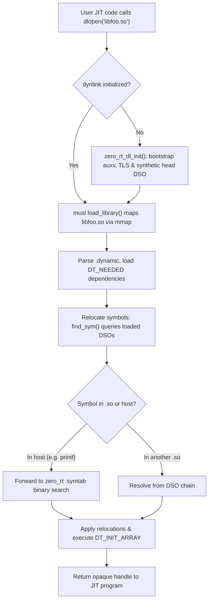

# Host Runtime, In-Process Dynamic Loading & Portability Architecture

This concept document defines the architectural strategy for ZeroCC's host runtime, self-contained static execution, JIT symbol resolution, freestanding/baremetal deployment, and portability across non-Linux operating systems.

- **Root Navigator**: [index.md](./index.md)
- **Freestanding Runtime Target**: [zero-rt.md](./zero-rt.md)
- **Internal Linker**: [own-linker.md](./own-linker.md)
- **ISA Backends**: [isa-backends.md](./isa-backends.md)

---

## 1. Static-Musl Host Toolchain & Current JIT Architecture

Starting in Sprint 143, `build/bin/zerocc` and test executables linking the compiler are fully statically linked against in-tree vendored musl (`third_party/vendor/musl/musl-1.2.6`), removing all runtime dependencies on host glibc (`ldd: "not a dynamic executable"`).

### Core Mechanics
1. **`--whole-archive $(MUSL_LIBC)`**:
   Static linkers only pull objects from an archive if referenced by the compiler binary. Because the compiler itself never calls user math routines (`sin`, `cos`, `pow`), formatting utilities, or POSIX sockets, `--whole-archive` bakes the entire musl C library into the executable's `.symtab`.
2. **Self-Hosting `dlfcn` (`zero_rt/dlfcn/dlfcn.c`)**:
   Static musl ships dummy stubs for `dlopen`/`dlsym`/`dlclose`/`dlerror` that always fail (`"Dynamic loading not supported"`). The build strips these stubs from `libc.a`. ZeroCC provides a self-hosting `dlfcn` linked ahead of musl:
   - On first call, it inspects its own ELF `.symtab` via `/proc/self/exe`.
   - Parses the section headers (`SHT_SYMTAB`), builds an in-memory index, and sorts symbols by name.
   - `dlsym(RTLD_DEFAULT, sym)` executes an $O(\log N)$ binary search over the process's own symbol table.
3. **`-no-pie` (Static `ET_EXEC`)**:
   Keeps `.symtab` `st_value` addresses absolute, avoiding the need to compute runtime ASLR load base offsets (though `ET_DYN` fallback is supported via `/proc/self/maps`).
4. **Far-Call Trampoline Pool (`src/zero_cc/jit/execution.h`)**:
   The static executable image is mapped at low addresses (~`0x400000`), whereas anonymous `mmap` pages for JIT execution reside at high virtual addresses (~128 GB away). Because x86-64 `call rel32` only reaches $\pm 2\text{ GB}$, the JIT reserves a 14-byte detour trampoline pool (`ff 25 00 00 00 00` + 8-byte absolute address) in the executable JIT region so standard calls can reach libc.

---

## 2. In-Process Dynamic Linker Adaptation (`musl ldso/dynlink.c`)

### The Limitations of the Current Approach
1. **No Third-Party `.so` Loading**: JITed user programs cannot dynamically load external shared libraries via `dlopen("libfoo.so")`.
2. **`/proc` Dependency**: Reading `.symtab` requires `/proc/self/exe`. In restricted environments (chroots, secure containers without procfs, baremetal), JIT symbol resolution fails.

### The Static `dlopen` Adaptation
To resolve these limitations without sacrificing static hermeticity, ZeroCC adapts musl's own dynamic loader (`third_party/vendor/musl/musl-1.2.6/ldso/dynlink.c`) into `zero_rt/dlfcn/`:

1. **Synthetic `head` DSO**: A bootstrap routine (`zero_rt_dl_init`) initialises musl's internal dynamic linker state, creating a synthetic root DSO representing the static executable.
2. **Symbol Bridging**: In `dynlink.c`, symbol searches on `head` forward to ZeroCC's existing `.symtab` lookup, making all whole-archived musl symbols available to loaded `.so` files.
3. **Embedded Symbol Table (`.rodata`)**: To eliminate `/proc/self/exe`, a build step extracts `.symtab` into a static `const BuiltinSym g_embedded_syms[]` array placed in `.rodata`. Symbol resolution performs an in-memory binary search with zero filesystem access.
4. **Why `--whole-archive` Remains Mandatory**: User JIT code does not explicitly `dlopen("libc.so")` to call `printf` or `sin`. The entire C runtime must remain present in the host binary image.

---

## 3. Freestanding & Baremetal Execution Architecture

In a freestanding environment (embedded microcontrollers, kernels, bootloaders, or IoT devices without an OS), dynamic loading and POSIX syscalls do not exist.

### AOT Mode (`--zerocc-link`)
ZeroCC compiles directly for freestanding targets using [`zero_rt.a`](./zero-rt.md):
- **Zero Host libc / Musl**: Programs link against `zero_rt.a` (written in clean C, compiled by ZeroCC itself).
- **Hardware BSP Boundary**: The OS syscall boundary (`zero_rt/linux/os.c`) is replaced by a Board Support Package (BSP):
  - `write()` routes to a hardware UART MMIO FIFO.
  - `brk()` / `sbrk()` bumps a pointer from the linker script's `_end` symbol in RAM.
  - `exit()` halts the CPU via `hlt` or `wfi`.

### Baremetal JIT & Dynamic Code Execution
When dynamic code execution is required on baremetal (e.g. in-kernel JIT, eBPF, firmware plugins):
1. **Flash Symbol Registry**: Symbol lookup queries a `const BaremetalSym g_firmware_symbols[]` table stored in ROM/Flash.
2. **Static RAM Allocation**: JIT code is written to a pre-allocated static RAM pool (`uint8_t g_jit_pool[]`).
3. **Instruction Cache Maintenance**: The JIT flushes data caches and invalidates instruction caches:
   - **RISC-V**: `fence.i`
   - **AArch64 / ARM**: `dsb ish; ic iallu; isb`
4. **Relocatable ELF Modules (`.o`)**: Instead of complex `.so` dynamic libraries, baremetal systems load static relocatable `.o` objects and resolve relocations in-place in RAM.

---

## 4. Non-Linux Host Portability Architecture

Because musl is Linux-specific (issuing Linux `syscall` instructions directly), non-Linux host platforms require native runtime adaptations:

| Operating System | Executable Format | Host C Runtime | Executable Path Discovery | JIT Memory Allocation | Dynamic Symbol Resolution |
| :--- | :--- | :--- | :--- | :--- | :--- |
| **Linux (Default)** | ELF (static `ET_EXEC`) | Vendored musl (`libc.a`) | `/proc/self/exe` (or `.rodata` symtab) | `mmap` + detour trampolines | `zero_rt/dlfcn/dlfcn.c` (.symtab search) |
| **macOS (Darwin)** | Mach-O | `libSystem.B.dylib` (dynamic only) | `_NSGetExecutablePath()` | `mmap` + `pthread_jit_write_protect_np()` | Native `dlsym(RTLD_DEFAULT)` |
| **Windows** | PE/COFF | Static UCRT (`/MT`) or Mingw | `GetModuleFileNameA()` | `VirtualAlloc()` + `FlushInstructionCache()` | `GetProcAddress(GetModuleHandle(NULL))` |
| **BSDs (FreeBSD/OpenBSD)** | ELF | Native BSD libc | `sysctl(KERN_PROC_PATHNAME)` | `mmap` (OpenBSD requires `wxneeded`) | Native BSD `dlsym` |

### Key Platform-Specific Invariants
- **macOS W^X Security**: Darwin strictly forbids pages that are simultaneously W and X. On Apple Silicon, code emission must be wrapped in `pthread_jit_write_protect_np(0)` (write mode) and `pthread_jit_write_protect_np(1)` (execute mode) with the `allow-jit` entitlement.
- **Windows Memory**: Replaces POSIX `mmap` with `VirtualAlloc(PAGE_EXECUTE_READWRITE)` and explicitly calls `FlushInstructionCache()`.
- **OpenBSD Security**: Requires linking with `-Wl,-z,wxneeded` and executing `pledge("prot_exec", ...)` to permit JIT execution.
