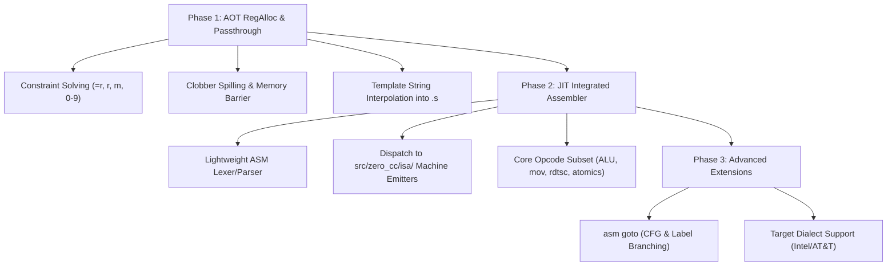

# Integrated Inline Assembly Roadmap

> **Status (Sprint 137):** **Phases 1, 2, and 3 are complete** for x86-64:
> - **Phase 1 (AOT text path)**: Non-empty GNU asm templates lower to `OP_ASM` (operand side table `IRAsmArgs`), the LRA honors `no_spill`/fixed-register/`forbidden_mask` operand constraints, and the substituted template is emitted between `#APP`/`#NO_APP` in the `.s` stream.
> - **Phase 2 (JIT & Raw Binary AOT)**: Integrated x86-64 inline assembler (`src/zero_cc/isa/x86_64_inline_asm.c`) tokenizes interpolated AT&T assembly statements, encodes Tier 1 & Tier 2 instructions directly into `c->text_section`, allowing `--run` (JIT) and `ZC_RAW_AOT=1` (raw ELF emission) to execute non-empty templates without invoking external assemblers.
> - **Phase 3 (asm goto & Dialects)**: `asm goto` statements parsed with C label target lists, CFG edges wired to labels + fallthrough, `%l0`..`%lN` and symbolic `%l[name]` label operand expansion, forward/backward branch displacement patching in machine code emission, and dialect alternatives `{att | intel}` automatically resolved.
> Differential gate: `make test-asm` (`tools/asm_diff.py`) sweeps all 3 execution paths (`text`, `jit`, `raw`) at `-O0..-O3` (48/48 runs passed).

This document outlines the architectural plan for bringing first-class **inline assembly (`__asm__` / `asm`)** support to ZeroCC, progressing from AOT constraint-solving and register-allocation passthrough to a Clang-style **integrated assembler** for in-memory JIT execution (`--run`).

---

## 1. Current State & Baseline

ZeroCC currently implements the following subset of inline assembly features:

1. **Syntax Parsing (`src/zero_cc/parser/ast_stmt.h:73-163`)**:
   - Parses the complete GNU extended assembly structure:
     `__asm__ [volatile] ( "template" : outputs : inputs : clobbers )`
   - Recognizes modifiers (`=`, `+`, `&`), register/memory constraints (`r`, `m`), matching digits (`0`–`9`), and clobber lists (`"memory"`, `"cc"`).
2. **Optimization & Memory Barriers**:
   - Empty templates (`"" : : : "memory"`) and constraint-only assignments (`"" : "=r"(x) : "0"(y)`) are recognized and lowered as compiler/memory barriers and identity assignments.
3. **Symbol Redirection (`__asm__("symbol")`)**:
   - GNU asm label redirection on function and variable declarations (`src/zero_cc/parser/zero_cc_declarator_stack.h:126`) is fully implemented across AOT and JIT.
4. **Current Status & Scope**:
   - Non-empty templates are supported on **x86-64 across all three compilation and execution modes**:
     - **AOT text path** (`-S`, `-c`, `-o` using external assembler/linker)
     - **In-memory JIT execution** (`--run`)
     - **Standalone raw binary emission** (`ZC_RAW_AOT=1`)
   - AArch64/RISC-V non-empty template support is planned for Phase 3 (since asm templates contain target-specific machine instructions). Low-level OS calls across all architectures can also use the compiler's native intrinsic [`__zerocc_syscall(...)`](./zero-rt.md).

---

## 2. Target Design: Clang-Style vs. GCC-Style

* **GCC-Style (Textual Passthrough)**:
  - GCC substitutes register names into the string template and writes the raw text into the `.s` output file, delegating instruction encoding and validation entirely to an external assembler (`GNU as`).
  - *Limitation*: Requires an external toolchain (`as`), which breaks ZeroCC's standalone JIT engine (`--run`) and self-hosting zero-dependency goals.
* **Clang-Style (Integrated Assembler)**:
  - Clang's integrated assembler (LLVM MC) tokenizes, type-checks, and directly encodes assembly mnemonics into machine code bytes in-memory.
  - *Advantage for ZeroCC*: Enables fast in-memory JIT execution, immediate compile-time diagnostics with exact line/column indicators within the asm string, and standalone raw ELF object generation (`ZC_RAW_AOT=1`) without external assembler dependencies.

ZeroCC will adopt a **hybrid, phased approach**: Phase 1 enables AOT passthrough; Phase 2 introduces a lightweight integrated assembler leveraging existing ISA emitters for JIT.

---

## 3. Phased Implementation Roadmap

### Phase 1: AOT Register Allocation & Passthrough (Milestone 1) — ✅ IMPLEMENTED (Sprint 135)

**As built** (see [Two-Pass IR & Register Allocation](./ir-and-regalloc.md) §“Inline-Asm Operand Side Table” and [Optimization Passes](./optimization-passes.md) §“OP_ASM barrier contract” for the invariants):
- `OP_ASM` IR op + `IRAsmArgsArena` side table (template, `ops[16]` in **GCC order: outputs then inputs**, `clobber_mask`, `has_memory`); remapped through every arena-rebuilding pass (LICM/branchless rebuilds, DCE compaction).
- Constraint subset: `r`/`m` with `=`/`+`, matching digits `0`-`7` (a digit input on an `=r` output seeds the register with the input expression’s value), fixed letters `a`/`b`/`d`/`S`/`D` in the LRA’s **hardware** index space (`c` rejected — RCX is the shift-count register); `m` operands must be lvalue forms (a value operand would be dereferenced as a pointer). Everything else — earlyclobber `&`, other constraints, FP/struct/128-bit operands, `rsp`/`rbp` clobbers, non-x86-64 targets — is a clean reject.
- LRA: operand temps `no_spill` (pressure → clean diagnostic); fixed letters pre-colored; `forbidden_mask` = the asm’s `clobber_mask` keeps operands out of clobbered registers; a post-allocation pass spills non-operand values live across a clobbered register (def-sensitive pending-return check).
- Barrier: `"memory"`/`volatile` → `has_memory`; DCE/LICM/GVN/mem2reg treat the op as a barrier, CSE/copy-prop reset their tables at it.
- Emitter: `x86_emit_inline_asm_asm` interpolates `%N`/`%qN`/`%lN`/`%wN`/`%bN`/`%aN`/`%%` with width-correct names between `#APP`/`#NO_APP`; `m` operands become memory refs.
- Gate: `make test-asm` (12/12) + `test/jit/inline_asm_barrier.c` in `make test-opt`.

**Original goal (as planned):** Enable compiling real-world C projects (Linux headers, crypto libraries, musl/glibc headers) that use inline assembly in AOT mode (`-S`, `-c`, `-o`).

1. **IR Node & Representation**:
   - Introduce an `OP_INLINE_ASM` IR instruction or attach operand lists to a dedicated AST node holding the raw template string, operand temps, constraints, and clobber lists.
2. **Constraint Solving & Register Allocator Integration**:
   - Map constraint letters to register classes:
     - `"r"` / `"=r"`: Allocate to any general-purpose register.
     - `"a"`, `"b"`, `"c"`, `"d"`, `"S"`, `"D"` (x86-64): Constrain to fixed physical registers (`%rax`, `%rbx`, `%rcx`, etc.).
     - `"m"`: Pass memory address temp.
     - `"0"`–`9"`: Bind input temp to the exact same physical register as output operand $N$.
3. **Clobber Handling**:
   - Treat `"memory"` as an alias-analysis barrier, forcing pending stack reloads and invalidating active `mem2reg` / `licm` / `cse` cache states.
   - For named register clobbers (`"rax"`, `"rcx"`, `"cc"`), mark the physical register unavailable in linear-scan allocation or emit spill/restore sequences around the block.
4. **String Template Interpolation**:
   - In `asm_emitter.c`, interpolate `%0`, `%1`, `%a0`, etc., replacing operand specifiers with the target ISA's syntax (e.g. `%eax`, `(%rdi)` or `x0`, `[x1]`).
   - Write the expanded string directly to the `.s` assembly stream.

---

### Phase 2: Lightweight JIT Integrated Assembler (Milestone 2) — ✅ IMPLEMENTED (Sprint 136)

**Goal:** Execute inline assembly in-memory under `--run` and in standalone raw binaries (`ZC_RAW_AOT=1`) without invoking external assemblers.

**As built (`src/zero_cc/isa/x86_64_inline_asm.c`)**:
1. **Lightweight AT&T Instruction Lexer & Parser**:
   - Parses operands: registers (`%rax`, `%eax`, `%ax`, `%al`, `%spl`, `%r8`–`%r15`), immediate values (`$imm`), and memory expressions (`disp(%base, %index, scale)` and `(%reg)`).
   - Template interpolation handles digit binding, operand width specifiers (`%qN`, `%lN`, `%wN`, `%bN`, `%aN`), and `%%` escapes into expanded AT&T assembly statements.
2. **Machine Code Emission**:
   - In `ast_lowering_mc.c`, intercepted `OP_ASM` delegates to backend vtable hook `.emit_inline_asm_mc` (`x86_emit_inline_asm_mc`).
   - Digit-bound inputs (`"0"(x)`) are pre-materialized into the shared register before statement execution using width-appropriate register moves (`movq`, `movl`, `movw`, `movb`).
   - Multiple statements separated by `;` or `\n` are parsed and encoded sequentially directly into `c->text_section`.
3. **Supported Instruction Subset**:
   - **Tier 1 (Core)**: `mov`, `add`, `sub`, `and`, `or`, `xor`, `cmp`, `test`, `not`, `neg`, `inc`, `dec`, `lea`, `push`, `pop`, `xchg`, `nop`, `rdtsc`, `cpuid`, `pause`, `syscall`, `cld`, `std`, `leave`, `ret`.
   - **Tier 2 (Atomics & Shifts)**: `cmpxchg`, `xadd` (with optional `lock` prefix), `shl`, `sal`, `shr`, `sar`, `rol`, `ror` (with immediate count or `%cl`).
4. **Verification**:
   - Extended `tools/asm_diff.py` to sweep all 3 execution paths (`text`, `jit`, `raw`) at `-O0..-O3` (36/36 runs passed).
   - Added dual-compiler test `test/jit/inline_asm_jit.c` exercised under `make test` and `make test-opt`.

---

### Phase 3: Advanced GNU Extensions (Milestone 3) — ✅ IMPLEMENTED (Sprint 137)

1. **`asm goto` Support**:
   - Parse `asm [volatile] goto ( "..." : outputs : inputs : clobbers : labels )`.
   - Propagate goto label names and IDs to `IRAsmArgs.goto_labels` and `IRAsmArgs.goto_label_names`.
   - Set `has_memory = 1` for all `asm goto` blocks (full optimizer barrier preventing unsafe code motion).
   - Connect inline asm blocks to the Control Flow Graph (`src/zero_cc/opt/cfg.c`), splitting basic blocks at `OP_ASM` (making the subsequent instruction a block leader) and creating outgoing CFG edges from the asm block to each target label block as well as the fallthrough successor block.
   - Interpolate label operands `%l0`..`%lN` and symbolic `%l[name]` in both AOT (`x86_64_asm.c`) and JIT/MC (`x86_64_inline_asm.c`) paths into target assembly labels (`.L<func_idx>_<ir_label>`).
   - Integrated assembler branch resolution: in `ast_lowering_mc.c` and `x86_64_inline_asm.c`, conditional jumps (`je`, `jne`, `jl`, `jle`, `jg`, `jge`, `jb`, `jae`, `jbe`, `ja`, etc.) and unconditional jumps (`jmp`) targeting `ASM_OP_LABEL` record forward patch sites or resolve backward branch displacements via `zc_mc_record_or_patch_label`.
2. **Dialect Alternatives (`{att | intel}`)**:
   - Added pre-filtering dialect extractors `x86_filter_dialect` and `x86_mc_filter_dialect` that evaluate `{att_syntax | intel_syntax}` alternative blocks inside template strings, selecting the default AT&T dialect prior to operand interpolation.
3. **Verification**:
   - Added `test/asm/asm_goto.c` exercising unconditional jumps, conditional branch fallthrough/taken paths, multi-target jumps, `asm goto` with outputs, empty templates, and dialect alternatives across `-O0..-O3`.
   - All 48/48 runs pass cleanly under `tools/asm_diff.py` across text (`-S`), JIT (`--run`), and raw AOT (`ZC_RAW_AOT=1`).

---

## 4. Verification & Testing Strategy

1. **Differential Unit Tests (`test/inline_asm/`)**:
   - Test basic ALU, register constraints, matching digit constraints, earlyclobber `&`, and `"memory"` barrier semantics.
   - Verify that test cases produce identical execution results under GCC, ZeroCC AOT, and ZeroCC JIT.
2. **Optimizer Invariant Sweeps (`make test-opt`)**:
   - Ensure `"memory"` clobbers correctly inhibit unsafe cross-asm store forwarding and loop-invariant code motion.
3. **Multi-ISA Raw QEMU Gate (`make test-isa-qemu`)**:
   - Verify that common inline assembly snippets (e.g. cycle counters, syscalls, atomics) assemble and execute correctly under QEMU on x86-64, AArch64, riscv64, and riscv32.
