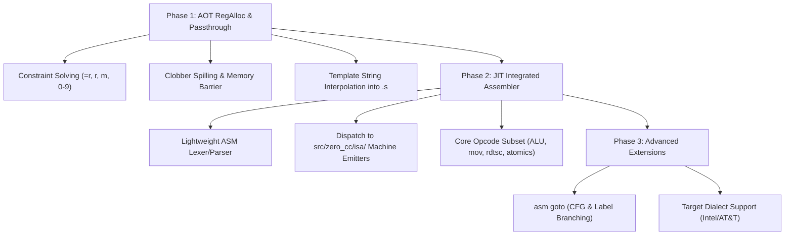

# Integrated Inline Assembly Roadmap

> **Status (Sprint 135):** **Phase 1 is complete** for the x86-64 AOT text
> path — non-empty GNU asm templates lower to `OP_ASM` (operand side table
> `IRAsmArgs`), the LRA honors `no_spill`/fixed-register/`forbidden_mask`
> operand constraints, and the substituted template is emitted between
> `#APP`/`#NO_APP` in the `.s` stream. Differential gate: `make test-asm`
> (`tools/asm_diff.py`). The JIT/raw path still rejects non-empty templates
> (Phase 2 below).

This document outlines the architectural plan for bringing first-class **inline assembly (`__asm__` / `asm`)** support to ZeroCC, progressing from AOT constraint-solving and register-allocation passthrough to a Clang-style **integrated assembler** for in-memory JIT execution (`--run`).

---

## 1. Current State & Baseline

ZeroCC currently implements the following subset of inline assembly features:

1. **Syntax Parsing (`src/zero_cc/parser/ast_stmt.h:73-163`)**:
   - Parses the complete GNU extended assembly structure:
     `__asm__ [volatile] ( "template" : outputs : inputs : clobbers )`
   - Recognizes modifiers (`=`, `+`, `&`), register/memory constraints (`r`, `m`), matching digits (`0`–`9`), and clobber lists (`"memory"`, `"cc"`).
2. **Optimization & Memory Barriers**:
   - Empty templates (`"" : : : "memory"`) and constraint-only assignments (`"" : "=r"(x) : "0"(y)`) are recognized and lowered as compiler/memory barriers and identity assignments.
3. **Symbol Redirection (`__asm__("symbol")`)**:
   - GNU asm label redirection on function and variable declarations (`src/zero_cc/parser/zero_cc_declarator_stack.h:126`) is fully implemented across AOT and JIT.
4. **Current Limitation (Phase 2+)**:
   - Non-empty templates are supported on the **x86-64 AOT text path**
     (Phase 1, Sprint 135 — see the status banner above). The **JIT /
     raw-emitter paths** still reject a non-empty template with a clean
     diagnostic pointing at Phase 2, and AArch64/RISC-V AOT text is a
     Phase 2/3 target (the template text is ISA-specific). Low-level OS
     calls can also use the compiler's native intrinsic [`__zerocc_syscall(...)`](./zero-rt.md).

---

## 2. Target Design: Clang-Style vs. GCC-Style

* **GCC-Style (Textual Passthrough)**:
  - GCC substitutes register names into the string template and writes the raw text into the `.s` output file, delegating instruction encoding and validation entirely to an external assembler (`GNU as`).
  - *Limitation*: Requires an external toolchain (`as`), which breaks ZeroCC's standalone JIT engine (`--run`) and self-hosting zero-dependency goals.
* **Clang-Style (Integrated Assembler)**:
  - Clang's integrated assembler (LLVM MC) tokenizes, type-checks, and directly encodes assembly mnemonics into machine code bytes in-memory.
  - *Advantage for ZeroCC*: Enables fast in-memory JIT execution, immediate compile-time diagnostics with exact line/column indicators within the asm string, and standalone raw ELF object generation (`ZC_RAW_AOT=1`) without external assembler dependencies.

ZeroCC will adopt a **hybrid, phased approach**: Phase 1 enables AOT passthrough; Phase 2 introduces a lightweight integrated assembler leveraging existing ISA emitters for JIT.

---

## 3. Phased Implementation Roadmap

### Phase 1: AOT Register Allocation & Passthrough (Milestone 1) — ✅ IMPLEMENTED (Sprint 135)

**As built** (see [Two-Pass IR & Register Allocation](./ir-and-regalloc.md) §“Inline-Asm Operand Side Table” and [Optimization Passes](./optimization-passes.md) §“OP_ASM barrier contract” for the invariants):
- `OP_ASM` IR op + `IRAsmArgsArena` side table (template, `ops[16]` in **GCC order: outputs then inputs**, `clobber_mask`, `has_memory`); remapped through every arena-rebuilding pass (LICM/branchless rebuilds, DCE compaction).
- Constraint subset: `r`/`m` with `=`/`+`, matching digits `0`-`7` (a digit input on an `=r` output seeds the register with the input expression’s value), fixed letters `a`/`b`/`d`/`S`/`D` in the LRA’s **hardware** index space (`c` rejected — RCX is the shift-count register); `m` operands must be lvalue forms (a value operand would be dereferenced as a pointer). Everything else — earlyclobber `&`, other constraints, FP/struct/128-bit operands, `rsp`/`rbp` clobbers, non-x86-64 targets — is a clean reject.
- LRA: operand temps `no_spill` (pressure → clean diagnostic); fixed letters pre-colored; `forbidden_mask` = the asm’s `clobber_mask` keeps operands out of clobbered registers; a post-allocation pass spills non-operand values live across a clobbered register (def-sensitive pending-return check).
- Barrier: `"memory"`/`volatile` → `has_memory`; DCE/LICM/GVN/mem2reg treat the op as a barrier, CSE/copy-prop reset their tables at it.
- Emitter: `x86_emit_inline_asm_asm` interpolates `%N`/`%qN`/`%lN`/`%wN`/`%bN`/`%aN`/`%%` with width-correct names between `#APP`/`#NO_APP`; `m` operands become memory refs.
- Gate: `make test-asm` (12/12) + `test/jit/inline_asm_barrier.c` in `make test-opt`.

**Original goal (as planned):** Enable compiling real-world C projects (Linux headers, crypto libraries, musl/glibc headers) that use inline assembly in AOT mode (`-S`, `-c`, `-o`).

1. **IR Node & Representation**:
   - Introduce an `OP_INLINE_ASM` IR instruction or attach operand lists to a dedicated AST node holding the raw template string, operand temps, constraints, and clobber lists.
2. **Constraint Solving & Register Allocator Integration**:
   - Map constraint letters to register classes:
     - `"r"` / `"=r"`: Allocate to any general-purpose register.
     - `"a"`, `"b"`, `"c"`, `"d"`, `"S"`, `"D"` (x86-64): Constrain to fixed physical registers (`%rax`, `%rbx`, `%rcx`, etc.).
     - `"m"`: Pass memory address temp.
     - `"0"`–`9"`: Bind input temp to the exact same physical register as output operand $N$.
3. **Clobber Handling**:
   - Treat `"memory"` as an alias-analysis barrier, forcing pending stack reloads and invalidating active `mem2reg` / `licm` / `cse` cache states.
   - For named register clobbers (`"rax"`, `"rcx"`, `"cc"`), mark the physical register unavailable in linear-scan allocation or emit spill/restore sequences around the block.
4. **String Template Interpolation**:
   - In `asm_emitter.c`, interpolate `%0`, `%1`, `%a0`, etc., replacing operand specifiers with the target ISA's syntax (e.g. `%eax`, `(%rdi)` or `x0`, `[x1]`).
   - Write the expanded string directly to the `.s` assembly stream.

---

### Phase 2: Lightweight JIT Integrated Assembler (Milestone 2)

**Goal:** Execute inline assembly in-memory under `--run` without invoking external assemblers.

1. **Lightweight Instruction Lexer & Parser**:
   - Create a fast tokenizer for inline asm snippets inside `src/zero_cc/parser/asm_inline_parse.c`.
   - Parse mnemonics, operands (registers, immediates, memory dereferences), and commas.
2. **Connecting to Existing ISA Binary Encoders**:
   - ZeroCC **already has** multi-ISA machine-code encoders in `src/zero_cc/isa/`:
     - `src/zero_cc/isa/x86_64.c`
     - `src/zero_cc/isa/aarch64.c`
     - `src/zero_cc/isa/riscv64.c`
     - `src/zero_cc/isa/riscv32.c`
   - Map parsed mnemonics directly to backend emitter functions:
     - `mov` / `movq` / `movl` $\rightarrow$ `zc_x86_emit_mov_reg()`, `zc_x86_emit_load()`
     - `add` / `sub` / `and` / `or` $\rightarrow$ `zc_x86_emit_alu()`
     - `syscall` / `svc` / `ecall` $\rightarrow$ `zc_emit_syscall()`
     - `rdtsc` / `cpuid` / `pause` $\rightarrow$ direct opcode byte emission.
3. **Incremental Instruction Set Burn-Down**:
   - **Tier 1 (Core)**: Data movement (`mov`), basic ALU (`add`, `sub`, `xor`), system instructions (`syscall`, `cpuid`, `rdtsc`, `nop`).
   - **Tier 2 (Atomics & Synchronization)**: `lock cmpxchg`, `mfence`, `lfence`, `sfence` (x86); `ldrex`/`strex`, `dmb` (AArch64); `lr`/`sc` (RISC-V).
   - **Tier 3 (SIMD & Float)**: Common vector/SSE operations.

---

### Phase 3: Advanced GNU Extensions (Milestone 3)

1. **`asm goto` Support**:
   - Parse `asm goto ( "..." : : inputs : clobbers : labels )`.
   - Connect inline asm blocks to the Control Flow Graph (`src/zero_cc/opt/cfg.c`), creating outgoing CFG edges to the specified C label targets.
2. **Intel Dialect Support (`-masm=intel`)**:
   - Add support for `.intel_syntax noprefix` inside template strings on x86-64.

---

## 4. Verification & Testing Strategy

1. **Differential Unit Tests (`test/inline_asm/`)**:
   - Test basic ALU, register constraints, matching digit constraints, earlyclobber `&`, and `"memory"` barrier semantics.
   - Verify that test cases produce identical execution results under GCC, ZeroCC AOT, and ZeroCC JIT.
2. **Optimizer Invariant Sweeps (`make test-opt`)**:
   - Ensure `"memory"` clobbers correctly inhibit unsafe cross-asm store forwarding and loop-invariant code motion.
3. **Multi-ISA Raw QEMU Gate (`make test-isa-qemu`)**:
   - Verify that common inline assembly snippets (e.g. cycle counters, syscalls, atomics) assemble and execute correctly under QEMU on x86-64, AArch64, riscv64, and riscv32.
