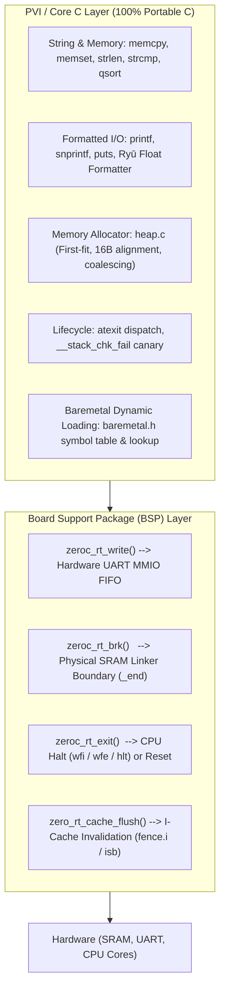

# Zero_RT — ZeroCC's Own Freestanding Runtime

**Phase 0 scope: Linux x86-64** (Sprint 49), extended in Sprint 55 to cross-architecture archives for AArch64 and RISC-V64, and Sprint 145 to RISC-V 32 (`zero_rt_riscv32.a`, completing all 4 target ISAs; see the closeout section below). The goal is for ZeroCC programs to need no system libc/crt: the runtime is owned by the project, compiled **by zerocc itself**, and linked by zerocc's own linker ([own-linker.md](./own-linker.md)).

## Layout (`zero_rt/`)

- `rt_os.h` — OS-boundary declarations. Syscalls go through the `__zerocc_syscall(...)` IR builtin (`OP_SYSCALL`, see [ir-and-regalloc.md](./ir-and-regalloc.md) and [isa-backends.md](./isa-backends.md)), which is implemented across all **4 target ISAs** (`x86_64` `syscall`, `aarch64` `svc #0`, `riscv64`/`riscv32` `ecall`) in both raw machine-code and GAS `.s` assembly emitters (Sprint 89), not inline asm.
- `linux/os.c` — syscall implementations: `read`, `write`, `brk`, `getpid`, `exit_group`.
- `core/heap.c` — `malloc`/`free`/`calloc`/`realloc` on a `brk`-backed first-fit allocator, plus the `-fsanitize=leak` atexit report (Sprint 169): `zeroc_rt_leak_report_set`/`zeroc_rt_leak_ignore` walk the arena at exit, report live blocks to fd 2 (stdio-free), and request exit code 23; the report is enabled by the `zeroc_leak_main_wrapper` entry (see `exit.c` below).
- `core/string.c` — `memcpy`/`memmove`/`memset`/`memcmp`, `strlen`/`strcpy`/`strcat`/etc.
- `core/exit.c` — `atexit`/`exit`/`abort` plus **`zeroc_main_wrapper`**: calls `main`, then `exit(status)`, so the atexit list runs on a plain `return` from `main`. **`zeroc_leak_main_wrapper`** (Sprint 169) is the `-fsanitize=leak` variant: it first calls `zeroc_rt_leak_report_set(1)`, then takes the same entry path; the own linker routes the `_start` stub through it when the driver requests it (and `exit()` honors `zeroc_rt_set_exit_override` — the leak report's exit 23 — only when the program would otherwise exit 0).
- `core/stdio.c` — unbuffered `printf`/`fprintf`/`sprintf`/`snprintf`/`puts`/`putchar`; float formatting via vendored **Ryū** (`third_party/vendor/ryu/`, Apache-2.0 OR Boost-1.0: `d2fixed_buffered` for `%f`, `d2exp_buffered` for `%e`/`%g`).
- `core/int128.c` — freestanding 128-bit integer div/mod/shift (`zc_udiv128`, `zc_sdiv128`, `zc_umod128`, `zc_smod128`, `zc_shl128_v`, `zc_shr128_v`, `zc_sar128_v`).
- `complex/complex.c` (Sprint 144) — clean-room MIT complex double division (`__divdc3`) using scaled Smith's algorithm (CACM 1962, Alg 116) and ISO C99 Annex G.5.1 infinity/NaN recovery. Closes the last `libgcc` runtime dependency called by ZeroCC IR lowering; linked as `ZC_COMPLEX_OBJ` into `zerocc` for host static musl JIT symbol resolution, and compiled into target `zero_rt.a` archives.
- `dlfcn/dlfcn.c` (Sprint 143, host side) — self-hosting `dlopen`/`dlsym`/`dlclose`/`dlerror` for static musl builds: resolves symbols by parsing the running executable's own ELF `.symtab` via `/proc/self/exe`. Not part of target `zero_rt.a` archives; linked into `zerocc` ahead of whole-archived musl `libc.a`. See [host-runtime-and-portability.md](./host-runtime-and-portability.md) for the in-process dynamic loader architecture (`dynlink.c` adaptation) and baremetal/non-Linux porting model.

## Threading Architecture (Dual-Path & C11 `<threads.h>`)

ZeroCC follows a **runtime-follows-link-mode** dual-path model for multithreading:
1. **Full POSIX Path (musl / host link)**: Programs requiring full POSIX compliance (cancellation points, thread-specific keys, signal masks, robust mutexes) link against musl `libc.a` / host libc, providing complete `pthreads` functionality.
2. **Freestanding Path (`zero_rt` & `--zerocc-link`)** (Sprint 146): To maintain a small, zero-dependency, self-contained runtime without dragging in full POSIX runtime complexity, `zero_rt` provides a lightweight ISO C11 `<threads.h>` runtime (`thrd_create`, `thrd_join`, `thrd_detach`, `thrd_exit`, `thrd_yield`, `thrd_current`, `thrd_equal`, `thrd_sleep`, `mtx_*`, `cnd_*`, `call_once`) plus POSIX `pthread_*` compatibility wrappers (`zero_rt/core/thread.c`).
   - **`__zerocc_clone` Intrinsic (`OP_CLONE`)**: Lowered in IR across all 4 ISAs (`x86_64`, `aarch64`, `riscv64`, `riscv32`) in both raw machine-code and GAS text assembly emitters, invoking Linux `SYS_clone` (syscall 56 on x86-64, 220 on arm64/riscv) with a child trampoline that pops the thread function and argument, executes the entry point, and invokes `SYS_exit` with the return code.
   - **Ulrich Drepper 3-State Mutex**: State `0` (unlocked), `1` (locked uncontended), `2` (locked contended). Fast paths execute single-instruction atomic CAS / fetch-sub; slow path suspends via Linux `SYS_futex` (`FUTEX_WAIT`, `FUTEX_WAKE`).
   - **Futex Domain Alignment**: Uses standard process-shared futexes (`FUTEX_WAIT = 0`, `FUTEX_WAKE = 1`) matching kernel `CLONE_CHILD_CLEARTID` wakeups on thread exit, avoiding lost wakeups in `thrd_join` / `pthread_join`.
   - **Thread-Safe Heap**: `zero_rt/core/heap.c` protects `malloc`, `free`, and `realloc` with an internal futex spin-wait lock.
   - **Atomic LL/SC Hardware CAS Loops**: Fixed AArch64 and RISC-V atomic CAS sequences to use proper LL/SC retry loops (`ldxr`/`stxr` + `cbnz`, `lr`/`sc` + `bnez`), eliminating spurious branch hangs.
   - **Verification**: `test/jit/thread_test.c` and `test/jit/pthread_test.c` differential-tested and validated under `--zerocc-link` natively on x86-64 and under QEMU on AArch64, RISC-V 64, and RISC-V 32 (`tools/verify/linker_tests.py`, 31/31 passed).

## Stack Protection Runtime Support (Sprint 147)

ZeroCC supports GCC/Clang-compatible `-fstack-protector[-all|-strong]` across all 4 ISAs:
- **Canary Guard & Failure Handler**: `zero_rt/core/exit.c` provides `uintptr_t __stack_chk_guard = 0x00000aff0a0d0a00ULL;` (terminator canary with NULL, LF, CR, 0xFF bytes) and `void __stack_chk_fail(void)` writing `*** stack smashing detected ***: terminated\n` to stderr (fd 2) and exiting with status 127 via `RT_SYS_EXIT_GROUP`.
- **x86-64 `%fs:40` TLS Initialization**: Under freestanding execution (`--zerocc-link`), `zeroc_main_wrapper` allocates a static TLS block `g_x86_tls_block[8]`, sets `g_x86_tls_block[5] = __stack_chk_guard`, and issues `arch_prctl(ARCH_SET_FS, g_x86_tls_block)` (`RT_SYS_ARCH_PRCTL 158`, `RT_ARCH_SET_FS 0x1002`). This matches host glibc/musl ABI where `%fs:40` holds the canary, ensuring identical canary checking code across JIT, host AOT, and freestanding execution.
- **AArch64 / RISC-V Guard Access**: On AArch64 and RISC-V, the compiler directly accesses `__stack_chk_guard` via PC-relative addressing (`adrp`+`add` or `auipc`+`addi`) and resolves through `zero_rt.a` or host libc.
- **Canary Frame Slot Placement**: Positioned at `BE(c)->callee_save_frame_reserve + 8` between local variables and callee-saved registers / frame pointer / return address so overflows corrupt the canary first.

Virtual freestanding headers in [`src/zero_cc/core/virtual_headers.h`](../../src/zero_cc/core/virtual_headers.h) (extracted from `core/preprocessor.h` in Sprint 80, with preprocessor expansion in [`src/zero_cc/core/preprocessor.c`](../../src/zero_cc/core/preprocessor.c)) provide `inttypes.h` (`stdint.h` + `PRI*`/`SCN*` macros), `assert.h` (always-evaluated, `abort()` on failure), `atexit` in `stdlib.h`, `immintrin.h` (Sprint 89), and full `<stdio.h>` stream declarations including `freopen`, `feof`, `ferror`, `clearerr`, and `ungetc` (Sprint 106). Non-local jumps (`setjmp`/`longjmp`, `__builtin_setjmp`/`__builtin_longjmp`) are lowered directly to inline multi-ISA `OP_SETJMP`/`OP_LONGJMP` instructions across all 4 ISAs (Sprint 88) without requiring any host libc helper.

## Build & Self-Compilation

`make all` builds `build/lib/zero_rt.a` **with zerocc itself** (`$(BUILD_DIR)/bin/zerocc -c zero_rt/... -O0`), then archives the objects with zerocc's own native archive writer (`$(BUILD_DIR)/bin/zerocc --ar rcs`, Sprint 148), achieving complete toolchain independence from host `ar`. The same rule also builds the cross archives `build/lib/zero_rt_aarch64.a`, `build/lib/zero_rt_riscv64.a`, and `build/lib/zero_rt_riscv32.a` (zerocc `--target aarch64` / `--target riscv64` / `--target riscv32` self-compilation + `--ar rcs`). The rules depend on `build/bin/zerocc`, so a compiler change rebuilds the runtime. Dead pre-Phase-0 Python tools live in `tools/archive/`.

## Auto-Linking (`--zerocc-link`)

In `compile_and_link` (`src/main.c`), when `--zerocc-link` is used the driver appends the matching zero_rt archive to the archive list: `zero_rt.a` for x86-64, `zero_rt_aarch64.a` for AArch64, `zero_rt_riscv64.a` for RISC-V64, and `zero_rt_riscv32.a` for RISC-V 32 (Sprint 145) — located via `$ZERO_RT_A` / `$ZERO_RT_AARCH64_A` / `$ZERO_RT_RISCV64_A` / `$ZERO_RT_RISCV32_A` or `../lib/<name>` relative to the zerocc binary (`/proc/self/exe`). **`--no-zerocc-rt`** disables it (tests linking plain programs against the raw `_start` stub keep working).

## Linker Changes for zero_rt (`src/zero_cc/linker/linker.c`)

- **Entry routing**: when the linked set contains zero_rt's `zeroc_main_wrapper`, the generated `_start` stub (see [own-linker.md](./own-linker.md)) calls the **wrapper** instead of `main`. The wrapper member is **force-extracted** from the archive (`member_defines(RT_ENTRY_WRAPPER)`) so it is present even if nothing references it; without zero_rt the stub keeps calling `main` directly.
- **Per-round re-resolve**: `extract_archives` re-runs `resolve_symbols` after any round that extracted new members, so a newly extracted member's undefined references (e.g. `zeroc_main_wrapper` → `main`, `stdio` → `os.write`) are visible to *subsequent* archive scans. Pre-fix the greedy extraction stopped one member short on exactly this pattern.
- **`elf_reader.c`**: `shoff` is parsed as a full 64-bit `Elf64_Shdr` offset (the old 16-bit mask broke section-header bounds checks for objects whose section table sits above 64 KiB).

## Phase 0 & Phase 1 Closeout (Sprint 49 & Sprint 55 — Resolved)

All `zero_rt` `printf` / `snprintf` / `sprintf` / `fprintf` / heap / string capabilities are 100% verified across host (x86-64) and cross-architectures (AArch64 and RISC-V 64-bit):
- **Cross Runtime Archives (`build/lib/zero_rt_aarch64.a`, `build/lib/zero_rt_riscv64.a`)**: Built directly with zerocc self-compilation (`--target aarch64`, `--target riscv64`) and auto-linked under `--zerocc-link` matching `--target` or sniffing input object `e_machine`.
- **AArch64 Relocations & Stores**: Fixed `R_AARCH64_ABS64`/`ABS32` relocation stomping lower 32 bits of pointer targets in `linker.c`, corrected `R_AARCH64_ADR_PREL_PG_HI21` instruction mask (`0x60FFFFE0`), and eliminated broken `param_save` offset calculations in `aarch64.c`.
- **RISC-V 64-bit Immediates & Branches**: Added full 64-bit immediate materialization in `riscv.c` (`slli 32` + low 32 bits ORed), inverted B-type branch skip (+8) over 20-bit JAL trampolines for >4KB jumps, and mapped variadic float args to GP register streams per psABI.
- **Syscall Non-Leaf Frame Safety & 4-ISA QEMU Gate (Sprint 89)**: `OP_SYSCALL` marks lowering functions as non-leaf, preventing x86-64 red zone stack omission (`alloc_frame_size = 0`) from corrupting stack variables during syscall register push/pop sequences; `aarch64_emit_syscall_asm` maintains 16-byte stack alignment (`112`-byte register save area) across `svc #0`; and [`test/isa_qemu/13_syscall.c`](../../test/isa_qemu/13_syscall.c) differential-tests `__zerocc_syscall` (`SYS_getpid`, `SYS_write`, `SYS_brk`) across all 4 ISAs (`x86_64`, `aarch64`, `riscv64`, `riscv32`) in both raw binary and `-S` assembly modes under `make test-isa-qemu`.
- **Linux Generic Syscalls**: Corrected `RT_SYS_BRK` to 214 and enabled `RT_HAS_BRK` for both AArch64 and RISC-V64. Fixed 64-bit heap allocation free-bit mask in `heap.c` and copy loops in `string.c`.

## Bare-Metal & Embedded Execution Architecture (Board Support Package Layer)

In freestanding bare-metal environments (microcontrollers, bootloaders, kernels, or embedded SoCs), there is **no Linux kernel**, **no POSIX syscall layer**, **no MMU virtual memory paging**, and **no filesystem**. `zero_rt` supports bare-metal targets through a **clean two-layer architecture**:



### 1. Two-Layer Separation: Core C Logic vs. Hardware BSP

- **Portable Pure-C Core (~95% of `zero_rt`)**:
  - `core/heap.c`, `core/string.c`, `core/stdio.c`, `core/exit.c`, `core/int128.c`, `complex/complex.c`, and `dlfcn/baremetal.h` are written in clean, ANSI/ISO C.
  - They execute without OS abstractions and compile directly to machine code using ZeroCC (`--target riscv32`, `aarch64`, `riscv64`, `x86_64`).
- **The Hardware BSP Boundary (`rt_os.h` / `linux/os.c`)**:
  - On Linux hosts, OS operations execute kernel syscall instructions (`syscall`, `svc #0`, `ecall`).
  - On bare metal, the platform boundary file is replaced by a lightweight **Board Support Package (BSP)** binding runtime functions directly to hardware registers.

### 2. Syscall to Bare-Metal Hardware Mapping

| Feature / Subsystem | Linux Kernel Target | Bare Metal BSP Equivalent |
| :--- | :--- | :--- |
| **`printf()` / Serial Console** | `write(1, buf, len)` syscall | Directly writes characters into a **Hardware UART MMIO FIFO** register (e.g., 16550, ARM PL011, STM32 USART). |
| **`malloc()` / Dynamic Heap** | `brk()` / `mmap()` syscalls | Bumps a pointer over a contiguous chunk of physical SRAM bounded by linker script symbols (`_end` to `_ram_end`). |
| **`exit()` / Termination** | `exit_group()` syscall | Runs registered `atexit` callbacks, then halts the CPU: executes `wfi` (RISC-V), `wfe` (ARM), or `hlt` (x86), or triggers a watchdog reset. |
| **Stack Canary Check** | Writes to stderr, exits 127 | Emits `"*** stack smashing detected ***"` over serial UART and enters an infinite trap/halt loop. |
| **Instruction Pipeline Sync** | Kernel `mprotect(PROT_EXEC)` | CPU-specific instruction cache invalidation: `fence.i` (RISC-V) or `isb` (ARM/AArch64). |

### 3. Subsystem Implementation Details

#### Heap Management on Physical SRAM (`core/heap.c`)
`zero_rt`'s allocator does not require page tables or virtual memory:
- It is a single-arena, first-fit allocator with 16-byte alignment and bidirectional block coalescing.
- On bare metal, `rt_arena_init()` is initialized from linker script boundaries:
  ```c
  extern char _end;       /* End of .bss in RAM (provided by linker script) */
  extern char _ram_end;   /* Top of physical SRAM */

  static uint8_t *g_baremetal_heap_ptr = (uint8_t *)&_end;

  uintptr_t zeroc_rt_brk(uintptr_t new_brk) {
      if (new_brk == 0) return (uintptr_t)g_baremetal_heap_ptr;
      if (new_brk > (uintptr_t)&_ram_end) return (uintptr_t)-1; /* Out of SRAM */
      g_baremetal_heap_ptr = (uint8_t *)new_brk;
      return new_brk;
  }
  ```
- All standard memory allocation calls (`malloc`, `free`, `calloc`, `realloc`) operate normally on physical RAM.

#### Serial Console I/O (`core/stdio.c`)
`printf()`, `puts()`, and `putchar()` format strings and floats (via Ryū) in memory and dispatch blocks through `zeroc_rt_write(1, buf, len)`:
```c
/* Bare metal BSP serial console driver */
intptr_t zeroc_rt_write(int fd, const void *buf, size_t count) {
    volatile uint32_t *uart_tx = (volatile uint32_t *)0x10000000; /* MMIO UART FIFO */
    const char *p = (const char *)buf;
    for (size_t i = 0; i < count; i++) {
        if (p[i] == '\n') *uart_tx = '\r'; /* CR-LF conversion */
        *uart_tx = p[i];
    }
    return count;
}
```

#### Core Halting on `exit()` or `abort()` (`core/exit.c`)
On bare metal, a process cannot return to an OS. Calling `exit(code)` or returning from `main()` runs registered `atexit` functions and enters low-power sleep:
```c
void zeroc_rt_exit_group(int code) {
    (void)code;
#if defined(__riscv)
    for (;;) { __asm__ volatile("wfi"); }
#elif defined(__aarch64__) || defined(__arm__)
    for (;;) { __asm__ volatile("wfe"); }
#elif defined(__x86_64__)
    for (;;) { __asm__ volatile("cli; hlt"); }
#endif
}
```

### 4. Dynamic Loading & Plugins on Bare Metal (`dlfcn/baremetal.h`)

For embedded systems supporting firmware plugins, JIT engines, or runtime diagnostics without an OS or filesystem:
1. **Flash Symbol Registry**: Exported firmware driver APIs are declared in a table in ROM/Flash:
   ```c
   static const BaremetalSym g_firmware_symbols[] = {
       { "uart_write",   (void *)uart_write },
       { "sensor_read",  (void *)sensor_read },
       { "gpio_set",     (void *)gpio_set },
   };

   zero_rt_baremetal_register_symbols(g_firmware_symbols, 3);
   ```
2. **In-Memory Symbol Resolution**: Calls to `zero_rt_baremetal_lookup("sensor_read")` resolve function pointers directly from Flash/RAM in constant or linear time without ELF parser overhead.
3. **Instruction Cache Invalidation (`zero_rt_cache_flush`)**:
   Modern Harvard-architecture microcontrollers feature separate instruction (I-cache) and data (D-cache) caches. When code is loaded into RAM, the instruction pipeline must be serialized:
   - **RISC-V**: issues `fence.i` (pipeline synchronization and I-cache invalidate).
   - **ARM / AArch64**: issues `isb` (instruction synchronization barrier).

## Related Concepts

- [Host Runtime & Non-POSIX Portability](./host-runtime-and-portability.md) — in-process dynamic loader, host musl, and cross-platform porting models.
- [ZeroCC Own Linker (T2)](./own-linker.md) — the linker zero_rt is linked with.
- [Multi-Translation-Unit Driver (T1)](./multi-tu.md)
- [Frontend, Type System & Semantic Analysis](./frontend-and-types.md) — string-literal array initializers (needed by runtime code).
- [Build, Test & Verification Guide](./build-and-verification.md)
